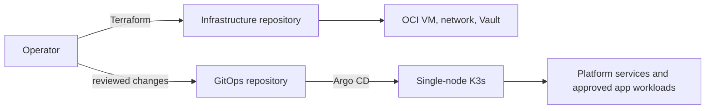
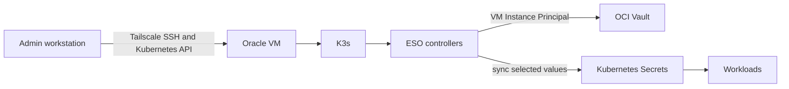
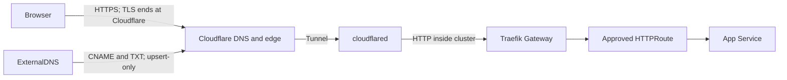

# Cluster architecture

This page is a short map of the Oracle cluster. Use the linked runbooks for
commands and change procedures.

## Ownership

Terraform owns OCI resources. Helmfile installs Argo CD. Argo CD owns the
checked-in cluster configuration. K3s owns its host-level Gateway API CRD
chart. See [bootstrap](bootstrap.md), [operations](operations/README.md), and
the [infrastructure guide](https://github.com/Disease-Prediction-ASET26/disease-prediction-infra/blob/main/README.md).

## Administration and secrets

K3s encrypts Kubernetes Secrets at rest. OCI Instance Principal is a VM-level
identity, not a pod identity. A pod that can reach OCI's metadata endpoint may
be able to use the VM's Vault permissions. Verify and control that access
before running untrusted workloads. See [secret operations](operations/secrets.md)
and [private access](operations/tailscale.md).

## Public request path

Name.com remains the registrar and delegates DNS to Cloudflare. The Tunnel
provides outbound connectivity; OCI exposes no inbound app ports. The internal
cloudflared-to-Traefik and Traefik-to-app hops use HTTP. Add origin TLS if an
application's requirements call for encryption inside the cluster. No app
route is currently published. See [domain and ingress](operations/domain-ingress.md).
