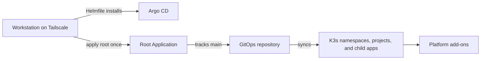

# Bootstrap the Oracle cluster

This guide installs Argo CD and connects it to the GitOps repository. It does not create OCI resources or expose an application hostname.

For a lost or replaced VM, follow the [single-node recovery guide](operations/recovery.md).

## Flow



See [cluster architecture](architecture.md) for system ownership and traffic paths.

## Before you start

- Follow the [Tailscale guide](operations/tailscale.md) and verify direct
  Kubernetes API access from your workstation. No SSH tunnel is needed.
- Install the pinned tools listed in [operations](operations/README.md#pinned-versions).
- Confirm `kubectl get nodes` shows the Oracle node as `Ready`.
- This GitHub repository is public. Argo CD reads it over HTTPS, so no Git credential is needed.

## Install Argo CD with Helmfile

The Argo CD namespace is a checked-in manifest. Review it, then create it:

```bash
kubectl diff -f platform/argocd/namespace.yaml
kubectl apply -f platform/argocd/namespace.yaml
```

Review the pinned chart release and values:

```bash
helmfile diff --diff-args "--allow-unreleased" --suppress-secrets
```

Install it after reviewing the diff. Add `--interactive` to require confirmation:

```bash
helmfile apply --interactive --diff-args "--allow-unreleased" --suppress-secrets
kubectl -n argocd get pods
```

Wait until the Argo CD pods are ready before continuing.

## Apply the checked-in cluster configuration

Before applying the root configuration, install the versioned Gateway API
chart and Traefik CRD bundle into K3s's auto-apply directory. The root app
creates Gateway API routes and the ForwardAuth Middleware, so their CRDs must
already be established. Follow the host-manifest steps in
[Kubernetes operations](operations/kubernetes.md#install-k3s-host-manifests).

The root configuration contains the Argo CD projects, application namespaces,
and root Application. Preview and apply it once:

```bash
kubectl diff -k clusters/oracle
kubectl apply -k clusters/oracle
kubectl -n argocd get applications,appprojects
```

The root Application follows `main`. After bootstrap, make changes in files, open a pull request, and merge after review. Argo CD then syncs the changes. App workloads are added only when their runnable ARM64 images and service contracts are ready.

## Bootstrap Argo CD through Kubernetes

The Helm values disable Argo CD's local `admin` account and anonymous access.
Before Authelia's OIDC secrets and public route are ready, use the CLI's core
mode with the trusted kubeconfig to manage Argo CD directly through Kubernetes:

```bash
argocd --core app list
argocd --core app sync oracle-root
```

Once OIDC is configured and the route is manually synced, sign in at
[`https://argocd.pocket-doc.app`](https://argocd.pocket-doc.app) through
Authelia. See the [Argo CD runbook](operations/argocd.md) for the activation
steps and emergency recovery.

The Kubernetes API remains private. This bootstrap does not expose an
application or configure public DNS; Argo CD's route is published later after
its Authelia OIDC configuration is ready.
