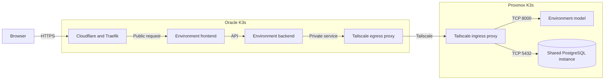

# Operate the Disease Prediction stacks

Dev and production have separate frontends, backends, model workloads, database
roles, and database credentials. The frontend and backend run on Oracle K3s.
The model workloads and PostgreSQL run on Proxmox K3s. The two databases share
one PostgreSQL instance and its availability, storage, and CPU.

| Environment | Public hostname | Oracle namespace | Proxmox namespace | Database |
|---|---|---|---|---|
| Dev | `dev.pocket-doc.app` | `disease-prediction` | `disease-prediction-dev` | `disease_prediction_dev` |
| Production | `health.pocket-doc.app` | `disease-prediction-prod` | `disease-prediction-prod` | `disease_prediction_prod` |

Both frontend routes are public and do not require login. The frontend proxies
`/api/` to its backend, so the API is also reachable without login. Hanko is
prepared but the app does not yet use it; see the [Hanko guide](hanko.md).
The backend calls its environment's model service and PostgreSQL through
separate Tailscale egress proxies. PostgreSQL also uses TLS with hostname and
CA verification. See the [domain and ingress guide](domain-ingress.md) for
route setup and the [Tailscale guide](tailscale.md) for the required tags,
service approvals, and access grants.



Each environment has a separate proxy identity and model service. Network
policies restrict application traffic to its environment's proxy. A proxy or
cluster outage interrupts its connections; the proxy groups and database have
one replica each.

## Model releases

Train and review classifiers outside K3s. The deployed service does not train.
Follow the [model training and release guide](https://github.com/Disease-Prediction-ASET26/disease-prediction-ai#model-training-and-release)
to package a reviewed classifier and record its digest and checksum. The dev
release uses the classifier pinned in `model-release-dev.json`. Production
uses the separately approved classifier pinned in `model-release-prod.json`.
To promote a new classifier, update the production release file and merge it
through `develop` to `main`.

The release workflow builds and checks native AMD64 and ARM64 images. It
includes the trained classifier and the pinned ClinicalBERT and MiniLM assets.
The runtime runs offline and does not download weights or use a model cache at
startup. A network policy denies outgoing connections from the model pods.
Its startup and readiness probes use `/ready` to load the model and parser
assets before serving requests. The liveness probe checks `/health` after
startup completes. Each Proxmox model pod requests 500m CPU and 2304 MiB
memory and has limits of 1200m CPU and 3 GiB memory. Review model outputs with
representative inputs before accepting a release; a successful build does not
establish clinical usefulness.

## Secrets

Use the [Secrets guide](secrets.md) to create the OCI Vault secrets used by
the Oracle backend and registry pull. Store JSON payloads with these fields:

| OCI Vault secret | JSON properties | Used by |
|---|---|---|
| `disease-prediction-runtime-secrets` | `data_encryption_key` | Dev backend |
| `disease-prediction-runtime-secrets-prod` | `data_encryption_key` | Production backend |
| `disease-prediction-ghcr-pull` | `username`, `token` | Both Oracle namespaces |
| `proxmox-postgres-credentials` | `password` | Dev database login |
| `proxmox-postgres-credentials-prod` | `password` | Production database login |
| `proxmox-postgres-server-ca` | `ca_crt` | Database TLS verification |

Keep separate encryption keys and database passwords for each environment.
The GHCR token needs read-only package access. Proxmox Vault holds the database
credentials and the model registry pull credential. Follow the
[Proxmox data services guide](proxmox-data-services.md) to set up or rotate
those values and configure Vault authentication. Do not put secret values in
Git or print Kubernetes Secrets.

Check synchronization without displaying values:

```bash
kubectl --context oracle-k3s -n disease-prediction get externalsecrets
kubectl --context oracle-k3s -n disease-prediction-prod get externalsecrets
kubectl --context proxmox-k3s -n disease-prediction-dev get externalsecrets
kubectl --context proxmox-k3s -n disease-prediction-prod get externalsecrets
```

Each ExternalSecret should report `Ready=True` before its workload starts.

## Review and deploy changes

Application CI builds and scans immutable images for AMD64 and ARM64. Each
service has an independent strict SemVer version. Bump the version in the
service's source file when publishing changed production content:

- Frontend: `package.json`.
- Backend: the root Maven `pom.xml` project version. Remove `-SNAPSHOT` for a
  release version.
- AI base and model-runtime images: the AI repository's root `VERSION` file.

CI publishes the stable `X.Y.Z` tag from `main` and a unique
`X.Y.Z-dev.<short-sha>.<run>.<attempt>` prerelease from `develop`. Pull request
preview images use an `X.Y.Z-pr.<number>.<short-sha>.<run>.<attempt>`
prerelease. Tags have no `v` prefix or `+build` metadata. CI rejects an attempt
to point an existing stable tag at different image content.

The GitOps update pins both the readable tag and immutable digest, for example
`ghcr.io/disease-prediction-aset26/disease-prediction-be:0.0.1@sha256:<digest>`.
The digest identifies the image content that Kubernetes runs. Current
digest-only refs will move to this form on their next normal CI image update.
A successful merge into `develop` updates the dev ref. A merge into
`main` updates the production ref, using the classifier approved in the
production release file for the model service. The GitHub App opens a GitOps
pull request and merges it only after GitOps validation and the secret scan
pass. If a check fails or a newer source revision replaces the build, inspect
the workflow and the open pull request. Argo CD syncs the merged tag-plus-digest
ref.

The GitHub App is installed only on the GitOps repository and needs Contents
and Pull requests write permissions. Configure `GITOPS_CLIENT_ID` and
`GITOPS_APP_PRIVATE_KEY` as Actions secrets in each application repository.
GitOps `main` requires the GitHub Actions `validate` and
`secret-scan / secret-scan` checks and an up-to-date branch. These protections
also prevent a concurrent merge from bypassing the checks.

From the GitOps repository root, render and review changes before opening a
pull request:

```bash
kubectl kustomize clusters/oracle
kubectl kustomize clusters/oracle/disease-prediction
kubectl kustomize clusters/oracle/disease-prediction-prod
kubectl kustomize clusters/oracle/auth/hanko
kubectl kustomize clusters/proxmox
kubectl kustomize clusters/proxmox/disease-prediction-ai/dev
kubectl kustomize clusters/proxmox/disease-prediction-ai/prod
git diff --check
git diff
```

Merge the checked pull request to `main`. Argo CD applies the Applications and
their resources. Do not apply managed manifests manually. After a change,
check both clusters:

```bash
kubectl --context oracle-k3s -n argocd get applications
kubectl --context oracle-k3s -n disease-prediction get deployments,pods,services,httproutes
kubectl --context oracle-k3s -n disease-prediction-prod get deployments,pods,services,httproutes
kubectl --context proxmox-k3s -n disease-prediction-dev get deployments,pods,services
kubectl --context proxmox-k3s -n disease-prediction-prod get deployments,pods,services
kubectl --context proxmox-k3s -n postgres get cluster postgres
```

Check that both hostnames load without an Authelia login. Check a synthetic
free-text and checklist assessment. A backend returns 422 when the model
cannot identify a symptom, 503 when it cannot connect, and 502 for other
upstream errors.

## Configuration and rollouts

Edit `config.env` in the matching Oracle application directory to change
backend settings. Kustomize adds a content hash to the generated ConfigMap
name and updates the backend Deployment reference. Argo CD applies the new
ConfigMap before the Deployment. A configuration change therefore starts a
new backend pod. Hanko uses the same pattern for `hanko-dev-config.yaml` and
`hanko-prod-config.yaml`; see the [Hanko guide](hanko.md).

The Oracle dev frontend and backend and both Hanko Deployments use one replica
with a surge of one and no unavailable replicas during a rollout. Production
uses two frontend and two backend replicas. Its rollouts use no surge and allow
one unavailable replica per Deployment, so one pod remains available while
Kubernetes replaces the other. This fits the production namespace quota: both
frontends and backends together request 250m CPU and 640 MiB memory, with
limits of 1200m CPU and 1792 MiB memory. The limits leave 256 MiB of the
namespace's 2 GiB memory quota free. A failed replacement leaves the other pod
serving; check rollout status and events. These replicas share one Oracle VM,
so they do not protect against a VM or cluster outage. Readiness also does not
prove a request will succeed. Keep database migrations compatible with old
and new versions while they overlap.

The production backend's Hikari pool is capped at 10 connections per pod and
keeps at least two idle connections. The production PostgreSQL role allows 35
connections. That covers three backend pools during a replacement, with five
connections left for maintenance. Keep this limit in step with the backend
pool size and rollout strategy. Do not increase replicas or the pool size
without checking the PostgreSQL role limit and the single AI service's load.

External Secrets Operator updates Kubernetes Secrets separately. ConfigMap
hashes do not cause a rollout when a Secret changes. Follow the
[Secrets guide](secrets.md) and the service's rotation procedure.

The Oracle dev and production Applications automatically prune old generated
backend ConfigMaps after the other resources become healthy. Their generated
ConfigMaps opt in to pruning. Other resources require confirmation before
pruning. In the Argo CD UI, review every pending deletion and confirm only if
all are intended. Confirmation applies to the Application's pending prune
operation. If a rollout fails, investigate it before removing the old
ConfigMap. Automatic pruning remains disabled for Hanko and the other
Applications.

Prune confirmation does not protect resources when an Application is deleted
with cascading deletion. Follow the removal procedure below and back up data
before removing any Application.

### Remove old generated ConfigMaps

Pruning is disabled for Hanko. After each Hanko configuration change and
successful rollout, remove its obsolete generated ConfigMaps to avoid leaving
unused versions and the Application out of sync. Run these commands from a
machine with access to Oracle K3s:

```bash
kubectl --context oracle-k3s -n auth-system get configmaps
kubectl --context oracle-k3s -n auth-system get pods -o json | jq -r '
  .items[] | .metadata.name as $pod |
  ((.spec.volumes[]?.configMap.name // empty),
   (.spec.initContainers[]?.envFrom[]?.configMapRef.name // empty),
   (.spec.containers[]?.envFrom[]?.configMapRef.name // empty)) |
  "\($pod) \(.)"'
```

Check that the old pod has terminated and no pod lists the old ConfigMap.
Select only obsolete `hanko-dev-config` or `hanko-prod-config` names. Do not
delete the current ConfigMap or other Hanko ConfigMaps. Delete each confirmed
obsolete name and check its Argo CD Application:

```bash
kubectl --context oracle-k3s -n auth-system delete configmap <obsolete-name>
kubectl --context oracle-k3s -n argocd get application hanko
```

For a rollback, restore the previous config in Git. Kustomize recreates its
matching ConfigMap, and Argo CD rolls out the restored reference.

## Roll back or remove a stack

To roll back, restore the previously working tag-plus-digest ref or manifest in
a GitOps pull request and merge it. Argo CD applies the restored version.
Confirm the pod rollout and the route afterward. Never promote a moving image
tag as a rollback.

The Oracle Applications require confirmation to prune non-generated resources.
The Proxmox Applications use `prune: false`. To remove a stack, first remove its
Application entries from the Oracle and Proxmox `applications/kustomization.yaml`
files and merge the change. Then delete the corresponding Application objects
with their resource finalizers so Argo CD removes their managed workloads. For
example, for production:

```bash
kubectl --context oracle-k3s -n argocd delete application disease-prediction-prod
kubectl --context proxmox-k3s -n argocd delete application disease-prediction-ai-prod
```

Check that the Deployments, Services, and HTTPRoute are gone before removing
its secrets or Tailscale access. Removing an application does not delete its
PostgreSQL database. Follow the [data services guide](proxmox-data-services.md)
for database and Vault removal.
