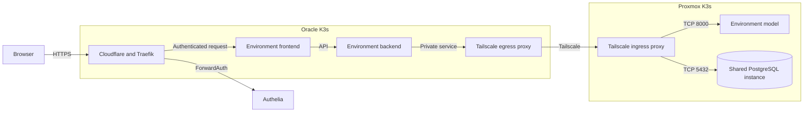

# Operate the Disease Prediction stacks

Dev and production have separate frontends, backends, model workloads, database
roles, and database credentials. The frontend and backend run on Oracle K3s.
The model workloads and PostgreSQL run on Proxmox K3s. The two databases share
one PostgreSQL instance and its availability, storage, and CPU.

| Environment | Public hostname | Oracle namespace | Proxmox namespace | Database |
|---|---|---|---|---|
| Dev | `dev.pocket-doc.app` | `disease-prediction` | `disease-prediction-dev` | `disease_prediction_dev` |
| Production | `health.pocket-doc.app` | `disease-prediction-prod` | `disease-prediction-prod` | `disease_prediction_prod` |

Both routes use Traefik and Authelia ForwardAuth with two-factor login. Only
the frontend has a public route. The frontend proxies `/api/` to its backend.
The backend calls its environment's model service and PostgreSQL through
separate Tailscale egress proxies. PostgreSQL also uses TLS with hostname and
CA verification. See the [domain and ingress guide](domain-ingress.md) for
route setup and the [Tailscale guide](tailscale.md) for the required tags,
service approvals, and access grants.



Each environment has a separate proxy identity and model service. Network
policies restrict application traffic to its environment's proxy. A proxy or
cluster outage interrupts its connections; the proxy groups and database have
one replica each.

## Model releases

Train and review classifiers outside K3s. The deployed service does not train.
Follow the [model training and release guide](https://github.com/Disease-Prediction-ASET26/disease-prediction-ai#model-training-and-release)
to package a reviewed classifier and record its digest and checksum. The dev
release uses the classifier pinned in `model-release-dev.json`. Production
uses the separately approved classifier pinned in `model-release-prod.json`.
To promote a new classifier, update the production release file and merge it
through `develop` to `main`.

The release workflow builds and checks native AMD64 and ARM64 images. It
includes the trained classifier and the pinned ClinicalBERT and MiniLM assets.
The runtime runs offline and does not download weights or use a model cache at
startup. A network policy denies outgoing connections from the model pods.
Its `/ready` probe loads the model and parser assets before serving
requests. Each Proxmox model pod requests 500m CPU and 2304 MiB memory and has
limits of 1200m CPU and 3 GiB memory. Review model outputs with representative
inputs before accepting a release; a successful build does not establish
clinical usefulness.

## Secrets

Use the [Secrets guide](secrets.md) to create the OCI Vault secrets used by
the Oracle backend and registry pull. Store JSON payloads with these fields:

| OCI Vault secret | JSON properties | Used by |
|---|---|---|
| `disease-prediction-runtime-secrets` | `data_encryption_key` | Dev backend |
| `disease-prediction-runtime-secrets-prod` | `data_encryption_key` | Production backend |
| `disease-prediction-ghcr-pull` | `username`, `token` | Both Oracle namespaces |
| `proxmox-postgres-credentials` | `password` | Dev database login |
| `proxmox-postgres-credentials-prod` | `password` | Production database login |
| `proxmox-postgres-server-ca` | `ca_crt` | Database TLS verification |

Keep separate encryption keys and database passwords for each environment.
The GHCR token needs read-only package access. Proxmox Vault holds the database
credentials and the model registry pull credential. Follow the
[Proxmox data services guide](proxmox-data-services.md) to set up or rotate
those values and configure Vault authentication. Do not put secret values in
Git or print Kubernetes Secrets.

Check synchronization without displaying values:

```bash
kubectl --context oracle-k3s -n disease-prediction get externalsecrets
kubectl --context oracle-k3s -n disease-prediction-prod get externalsecrets
kubectl --context proxmox-k3s -n disease-prediction-dev get externalsecrets
kubectl --context proxmox-k3s -n disease-prediction-prod get externalsecrets
```

Each ExternalSecret should report `Ready=True` before its workload starts.

## Review and deploy changes

Application CI builds and scans immutable images for AMD64 and ARM64. A
successful merge into `develop` updates the dev digest. A merge into `main`
updates the production digest, using the classifier approved in the production
release file for the model service. The GitHub App opens a GitOps pull
request and merges it only after the GitOps validation and secret scan pass.
If a check fails or a newer source revision replaces the build, inspect the
workflow and the open pull request. Argo CD syncs the merged digest.

The GitHub App is installed only on the GitOps repository and needs Contents
and Pull requests write permissions. Configure `GITOPS_CLIENT_ID` and
`GITOPS_APP_PRIVATE_KEY` as Actions secrets in each application repository.
GitOps `main` requires the GitHub Actions `validate` and
`secret-scan / secret-scan` checks and an up-to-date branch. These protections
also prevent a concurrent merge from bypassing the checks.

From the GitOps repository root, render and review changes before opening a
pull request:

```bash
kubectl kustomize clusters/oracle
kubectl kustomize clusters/oracle/disease-prediction
kubectl kustomize clusters/oracle/disease-prediction-prod
kubectl kustomize clusters/proxmox
kubectl kustomize clusters/proxmox/disease-prediction-ai/dev
kubectl kustomize clusters/proxmox/disease-prediction-ai/prod
git diff --check
git diff
```

Merge the checked pull request to `main`. Argo CD applies the Applications and
their resources. Do not apply managed manifests manually. After a change,
check both clusters:

```bash
kubectl --context oracle-k3s -n argocd get applications
kubectl --context oracle-k3s -n disease-prediction get deployments,pods,services,httproutes
kubectl --context oracle-k3s -n disease-prediction-prod get deployments,pods,services,httproutes
kubectl --context proxmox-k3s -n disease-prediction-dev get deployments,pods,services
kubectl --context proxmox-k3s -n disease-prediction-prod get deployments,pods,services
kubectl --context proxmox-k3s -n postgres get cluster postgres
```

Check that an unauthenticated browser session is redirected to Authelia for
both hostnames. After logging in, check a synthetic free-text and checklist
assessment. A backend returns 422 when the model cannot identify a symptom,
503 when it cannot connect, and 502 for other upstream errors.

## Roll back or remove a stack

To roll back, restore the previously working immutable image digest or manifest
in a GitOps pull request and merge it. Argo CD applies the restored version.
Confirm the pod rollout and the protected route afterward. Never promote a
moving image tag as a rollback.

The Applications use `prune: false`. To remove a stack, first remove its
Application entries from the Oracle and Proxmox `applications/kustomization.yaml`
files and merge the change. Then delete the corresponding Application objects
with their resource finalizers so Argo CD removes their managed workloads. For
example, for production:

```bash
kubectl --context oracle-k3s -n argocd delete application disease-prediction-prod
kubectl --context proxmox-k3s -n argocd delete application disease-prediction-ai-prod
```

Check that the Deployments, Services, and HTTPRoute are gone before removing
its secrets or Tailscale access. Removing an application does not delete its
PostgreSQL database. Follow the [data services guide](proxmox-data-services.md)
for database and Vault removal.
