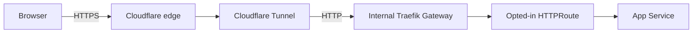
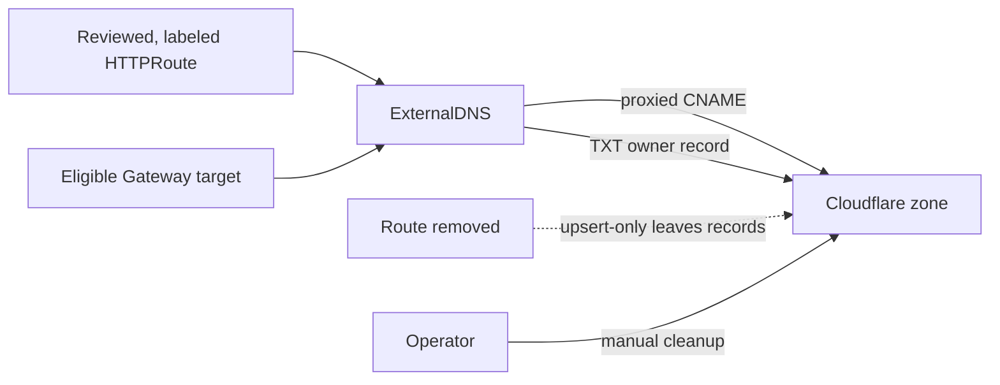

# Domain and public routes

This guide covers the public edge for `pocket-doc.app`. Name.com is the
registrar, while Cloudflare hosts DNS and the public edge. The Authelia login
portal is published at `auth.pocket-doc.app`. The Argo CD UI is published at
`argocd.pocket-doc.app` behind its native Authelia OIDC configuration. Grafana
is configured for `grafana.pocket-doc.app` with the same native OIDC
integration. Its separate route remains manual-sync until the Grafana OIDC
client is ready. Product workload routes still need their own reviewed route
and authentication configuration.

## How traffic reaches an app



Cloudflare handles browser-facing TLS. Traffic from `cloudflared` to Traefik,
and from Traefik to the app, uses HTTP inside the cluster. Add origin TLS if an
application requires encryption on those internal hops. The VM has no public
inbound rule for ports 80 or 443. Do not publish the Kubernetes API or SSH.
Argo CD and Grafana are reachable publicly only through their Gateway API
routes and native OIDC login; keep their Services ClusterIP-only.

## Current platform settings

- Name.com delegates the domain to Cloudflare. Cloudflare DNSSEC is enabled
  and the matching DS record is published at Name.com.
- The locally managed Tunnel `oracle-k3s` connects outbound to Cloudflare and
  forwards `*.pocket-doc.app` to Traefik's internal Service. A final catch-all
  returns 404. The tunnel credential is in OCI Vault as `cloudflared-tunnel`.
- Gateway API CRDs are owned by K3s through the checked-in host manifest. The
  Traefik CRD bundle is also installed from a version-matched K3s host
  manifest. Do not install a second CRD bundle.
- Traefik is an internal `ClusterIP` Gateway API controller. The `oracle-public`
  Gateway accepts routes only from namespaces labeled
  `pocket-doc.app/public-routes: "true"`.
- Traefik has namespaced read access in `traefik-system`, `disease-prediction`,
  `auth-system`, and `monitoring`. In the first three namespaces it can read
  Secrets; in `monitoring` it has a narrower Role for Services, Pods,
  EndpointSlices, and HTTPRoutes. Keep Grafana's OIDC Secret out of namespaces
  where Traefik can read Secrets.
- Traefik's web port allows pod-originated traffic only from the `cloudflared`
  pods in `edge-system`; Kubernetes NetworkPolicy does not restrict
  node-originated traffic. Its trusted forwarded-header range matches the K3s
  pod CIDR (`10.42.0.0/16`). Keep this range and the NetworkPolicy aligned if
  the pod network changes.
- Authelia and its HTTPRoute live in `auth-system`. Traefik has namespaced read
  access there, including Secrets; keep the namespace limited to authentication
  components. The login route has the `external-dns-public: "true"` label and
  Cloudflare proxy annotation.
- The `argocd-route` Application is in `argocd`, but its HTTPRoute and web proxy
  are in `auth-system`. The route uses Argo CD's native OIDC client against
  Authelia and does not use generic ForwardAuth. The manual-sync route has been
  published after OIDC was configured.
- The Grafana route is a separate manual-sync Application in `monitoring`.
  Grafana uses native OIDC with Authelia, disables local basic authentication,
  and maps the `admins` group to Grafana server administrator. The namespace is
  opted into public routes so the route can attach to `oracle-public`. Traefik
  has limited read access in `monitoring` to resolve the route and backend
  Service; its private HTTPS listener accepts OIDC back-channel requests from
  Grafana pods.
- Traefik has no namespaced role in `argocd` and cannot read the OIDC client
  Secret there. The proxy forwards to Argo CD's ClusterIP Service.
- ExternalDNS watches Gateway API HTTPRoutes only. A route must have
  `external-dns-public: "true"`, and its Gateway must pass the configured
  label filter. DNS is limited to `pocket-doc.app`, the configured Cloudflare
  zone, and CNAME records. Cloudflare proxying is requested on the route.
- ExternalDNS uses the TXT owner `oracle-k3s-pocket-doc-app`, prefix
  `external-dns-`, and policy `upsert-only`. It creates or updates records but
  never deletes them. Remove stale CNAME and TXT records manually in Cloudflare.
- The Cloudflare API token is stored in OCI Vault as `cloudflare-api-token`.
  ESO syncs it to `edge-system`; do not place its value in Git or Terraform.
  ExternalDNS's configured route and zone filters limit its behavior, while
  its Kubernetes ServiceAccount still has read permissions defined by its
  installed ClusterRole: Gateway and HTTPRoute resources, plus Namespaces,
  across the cluster. This is read-only discovery access; inspect the rendered
  ClusterRole when changing the chart or source configuration.

The DNS ownership path is:



The ExternalDNS domain, zone, label, and record-type filters limit what it
considers. The Cloudflare token still has DNS edit permission across the
selected zone; the filters are controller settings, not Cloudflare permission
boundaries.

## Internal OIDC traffic and geo restrictions

Argo CD keeps the public OIDC issuer `https://auth.pocket-doc.app`, so browser
redirects and issuer validation use the canonical host. A host alias in the
Argo pods sends server-side discovery, token, and userinfo requests for that
host to Traefik's ClusterIP. Traefik terminates TLS on a private HTTPS Gateway
listener using an Authelia Origin CA certificate, then forwards the request to
Authelia over the existing cluster HTTP Service. Argo CD trusts Cloudflare's
Origin CA root. This internal path avoids Cloudflare's country check for
Argo's back-channel requests while public browser traffic still passes through
Cloudflare.

The Origin certificate and private key come from OCI Vault and are synced into
`auth-system/authelia-origin-tls`; see the [Authelia runbook](authelia.md#prepare-the-internal-oidc-certificate).
Keep the Romania-only Cloudflare block for public requests. After confirming
Argo CD login works through the internal listener, remove any temporary
Cloudflare exception made for the Oracle egress IP and OIDC paths. Do not add
a broad IP allow rule. Cloudflare Origin CA certificates are not browser-
trusted, so browser traffic must continue to use Cloudflare's edge
certificate. The Origin CA root currently expires in 2029; rotate Argo CD's
trusted root before then. See Cloudflare's [Origin CA documentation](https://developers.cloudflare.com/ssl/origin-configuration/origin-ca/).

## Set up the registrar and Cloudflare zone

This setup is already complete. Use these steps if you move DNS providers or
rebuild the zone:

1. Add `pocket-doc.app` to Cloudflare. Compare imported DNS records with the
   registrar's current records and restore any required mail or verification
   records before delegation.
2. At Name.com, set the domain's nameservers to the exact pair Cloudflare
   assigns. Keep the registration at Name.com.
3. Wait until Cloudflare reports the zone as **Active**. Verify with
   `dig NS pocket-doc.app +short` and `dig SOA pocket-doc.app +short`.
4. Enable DNSSEC in Cloudflare. Publish Cloudflare's current DS values at
   Name.com; remove any stale DS before changing providers. Check with
   `dig +dnssec pocket-doc.app A` and `dig DS pocket-doc.app +short`.
5. Do not create VM A/AAAA records or use `cloudflared tunnel route dns` for
   app names. ExternalDNS owns approved app records.

Cloudflare documentation: [zone setup](https://developers.cloudflare.com/dns/get-started/),
[DNSSEC](https://developers.cloudflare.com/dns/dnssec/), and
[custom API tokens](https://developers.cloudflare.com/fundamentals/api/get-started/create-token/).

## Credentials and rotation

The ExternalDNS token is a Cloudflare custom API token with **Zone → DNS →
Edit** and **Zone → Zone → Read**, scoped to `pocket-doc.app`. ExternalDNS
also receives the zone ID as non-secret configuration. Prefer an expiration
when Cloudflare supports one for this account; otherwise set a review and
rotation reminder. Zone DNS Edit can change records throughout the zone even
though ExternalDNS is configured to manage only CNAMEs.

To rotate the token, create a replacement with the same scope, update the
`cloudflare-api-token` value in OCI Vault, confirm the ESO resource is Ready
and ExternalDNS has recovered, then revoke the old token. Never print the
Kubernetes Secret value.

The tunnel credential JSON belongs in OCI Vault secret `cloudflared-tunnel`.
The account certificate used to manage a locally managed tunnel stays on the
trusted workstation. Do not copy it to Kubernetes or Git.

## Publish an application route

Only publish an app after its API boundary, authentication, health behavior,
and ARM64 image are ready and public access is approved. In the app namespace:

1. Add namespace label `pocket-doc.app/public-routes: "true"` in the same
   reviewed change as its route.
2. Create an HTTPRoute attached to `oracle-public` in `traefik-system`. Use
   the app's hostname under `pocket-doc.app` and the app's internal Service.
3. For a route protected by Authelia, add the ForwardAuth filter to each rule.
   The shared Middleware is in the `disease-prediction` namespace:

   ```yaml
   filters:
     - type: ExtensionRef
       extensionRef:
         group: traefik.io
         kind: Middleware
         name: authelia-forwardauth
   ```

   The route still needs its backend reference. An app in another namespace
   must define its own namespaced Middleware and have it allowed by its
   AppProject; cross-namespace middleware references are not enabled.
   Argo CD and Grafana use native OIDC instead. See the [Argo CD runbook](argocd.md)
   and [observability runbook](observability.md); do not add ForwardAuth to
   those routes.
4. Add the ExternalDNS opt-in label and Cloudflare proxy annotation:

   ```yaml
   metadata:
     labels:
       external-dns-public: "true"
     annotations:
       external-dns.kubernetes.io/cloudflare-proxied: "true"
   ```

5. Render `clusters/oracle`, review the Argo CD project permissions and diff,
   then merge the change. Do not use a direct public IP, NodePort, or
   LoadBalancer.
6. Check route and Gateway status, DNS, TLS, and an HTTPS request:

   ```sh
   kubectl -n <app-namespace> get httproute <route-name>
   kubectl -n traefik-system get gateway oracle-public
   dig <app-host>.pocket-doc.app A
   curl -I https://<app-host>.pocket-doc.app/
   ```

ExternalDNS writes a proxied CNAME to the tunnel hostname and a prefixed TXT
ownership record. It does not create Tunnel ingress rules; the wildcard Tunnel
rule already forwards subdomains to Traefik. The apex `pocket-doc.app` is not
covered by `*.pocket-doc.app`.

## Remove a route or test records

Remove the route through a reviewed Git change. The root Argo CD app has
pruning disabled, so deleting a manifest alone does not remove the live
resource. Delete the child Application only if removing the entire app; for a
single route, delete the live HTTPRoute after its Git manifest is removed.

Because ExternalDNS is `upsert-only`, delete records manually only after
confirming they belong to the removed route. For the completed NGINX test,
remove these two records in **Cloudflare → pocket-doc.app → DNS → Records**:

- CNAME `external-dns-test` (`external-dns-test.pocket-doc.app`)
- TXT `external-dns-cname-external-dns-test`
  (`external-dns-cname-external-dns-test.pocket-doc.app`), with owner
  `oracle-k3s-pocket-doc-app`

Do not remove other domain, mail, or verification records. After deletion,
check the host in Cloudflare DNS; proxied records may resolve to Cloudflare edge
IPs instead of showing their CNAME target in ordinary DNS lookups.

To remove the edge platform, remove public routes first, then ExternalDNS and
its ESO-managed token, the Tunnel connector, Gateway, and Traefik. Manually
remove owned DNS records. Keep Vault secrets until their consumers are gone.

## Troubleshooting

- **No DNS record:** check ExternalDNS is Ready, the route's opt-in label, the
  Gateway label filter, route status, zone ID/domain filters, and controller
  logs. Do not print Secret values.
- **DNS resolves but the page fails:** check Cloudflare Tunnel health, the
  wildcard config, Gateway status, route parent conditions, and backend
  Service endpoints.
- **HTTPS works with curl but not a browser:** check local DNS cache and
  browser secure-DNS settings. Compare `Resolve-DnsName`/`dig` with a public
  resolver and try a clean browser session.
- **Traefik cannot reach a backend Pod IP:** the smoke test succeeded through
  the Service ClusterIP when the Service had
  `traefik.io/service.nativelb: "true"`. Diagnose cluster pod networking before
  choosing that setting for another app.

For admin access and cluster recovery, use the [Tailscale guide](tailscale.md),
[Authelia runbook](authelia.md), and [recovery runbook](recovery.md). Keep the
Kubernetes API private. Argo CD is only exposed through its Authelia OIDC
route.
