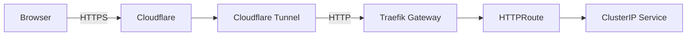

# Public routes

Use this guide to publish an app at `*.pocket-doc.app`. Name.com is the
registrar. Cloudflare provides DNS and the public edge.

## How a request reaches an app



Cloudflare handles browser TLS. The Tunnel connects outbound to Traefik. The
VM has no public web ports. Do not use a public IP, NodePort, or LoadBalancer
for an app.

## Cluster rules

- `oracle-public` is the public Gateway. A namespace must have the label
  `pocket-doc.app/public-routes: "true"` before its routes can attach.
- ExternalDNS reads HTTPRoutes. The route needs the
  `external-dns-public: "true"` label. Its Gateway also needs the
  `external-dns.pocket-doc.app/eligible: "true"` label.
- Traefik must watch a route's namespace and have a Role there. These are
  separate settings. The Roles are in
  [`reader-roles.yaml`](../../clusters/oracle/ingress/traefik-access/reader-roles.yaml);
  Traefik's chart does not create them.
- The app's Argo CD AppProject must allow the namespace and route resources.
- Traefik can read Secrets in each watched namespace. Keep unrelated sensitive
  workloads out of those namespaces. The current watch scope is
  `traefik-system`, `disease-prediction`, `disease-prediction-prod`,
  `auth-system`, and `monitoring`.
- ExternalDNS only manages the `pocket-doc.app` zone. It creates proxied CNAME
  and TXT ownership records. Its `upsert-only` policy does not delete records.

The Tunnel forwards `*.pocket-doc.app` to Traefik. It does not create DNS
records. ExternalDNS owns approved app records. The apex domain is not covered
by the wildcard Tunnel rule.

## Disease Prediction hostnames

Use separate names for each environment:

| Environment | Hostname | Status |
|---|---|---|
| Dev | `dev.pocket-doc.app` | Active route protected by Authelia ForwardAuth. |
| Production | `health.pocket-doc.app` | Reserved; the staged route uses Authelia ForwardAuth when activated. |

Both names use the `pocket-doc.app` zone. Keep the backend and AI Services
private, and send browser traffic only to the frontend. Protect both routes with
Authelia ForwardAuth unless the app later adds its own reviewed OIDC login.

## Choose Authelia login

- **ForwardAuth:** Traefik checks each request with Authelia. Use this for an
  app without its own OIDC login. Add the Middleware filter to each HTTPRoute
  rule. The shared Middleware is in `disease-prediction`; another namespace
  needs its own Middleware and Traefik CRD provider watch and RBAC access.
- **Native OIDC:** the app handles its own login and session. Use this when it
  needs app-specific roles or claims. Register the exact callback URL in
  Authelia and sync the client secret to the app namespace through ESO. Do not
  add ForwardAuth to the same route. Grafana and Argo CD use native OIDC; see
  their runbooks for app-specific setup.

The Authelia Middleware checks authentication. It does not create an app OIDC
session or configure app roles. See the
[Authelia guide](authelia.md) for secret and account setup.

## Add a route

First confirm the app is ready for public access: its API and authentication
are understood, its health checks work, and its ARM64 image is published. Keep
its Service as `ClusterIP`.

Check the three routing labels before you add the HTTPRoute:

| Resource | Required setting | What it allows |
|---|---|---|
| Namespace | `pocket-doc.app/public-routes: "true"` | Attach to `oracle-public` |
| HTTPRoute | `external-dns-public: "true"` | Create a DNS record |
| Gateway | `external-dns.pocket-doc.app/eligible: "true"` | Use the Gateway as a DNS target |

Also check the AppProject, Traefik Gateway provider watch, and namespaced
RBAC. If the route uses ForwardAuth, check the separate Traefik CRD provider
watch and RBAC. Do not enable cross-namespace Middleware references as a
shortcut.

This example uses the shared Middleware in `disease-prediction`. For another
namespace, create a local Middleware with the same name. For native OIDC,
remove the `filters` block and configure OIDC in the app.

```yaml
apiVersion: gateway.networking.k8s.io/v1
kind: HTTPRoute
metadata:
  name: <app-name>
  namespace: <app-namespace>
  labels:
    external-dns-public: "true"
  annotations:
    external-dns.kubernetes.io/cloudflare-proxied: "true"
spec:
  parentRefs:
    - name: oracle-public
      namespace: traefik-system
      sectionName: web
  hostnames:
    - <app-host>.pocket-doc.app
  rules:
    - matches:
        - path:
            type: PathPrefix
            value: /
      filters:
        - type: ExtensionRef
          extensionRef:
            group: traefik.io
            kind: Middleware
            name: authelia-forwardauth
      backendRefs:
        - name: <app-service>
          port: <service-port>
```

Add the namespace label and route in one reviewed Git change. Render the
Kustomize root and review the AppProject and Argo CD diff. Then merge and sync
the app's Application.

Check the route and its backend:

```sh
kubectl -n <app-namespace> get services,endpointslices
kubectl -n <app-namespace> get httproute <route-name> -o yaml
kubectl -n traefik-system get gateway oracle-public
dig <app-host>.pocket-doc.app A
curl -I https://<app-host>.pocket-doc.app/
```

The HTTPRoute's parent conditions must show `Accepted=True` and
`ResolvedRefs=True`. Test in a private browser session. Check that an
unauthenticated user is sent to Authelia, then verify both allowed and denied
app paths. Confirm there is no direct public Service, NodePort, or LoadBalancer.

## Manage DNS and the API token

When moving the zone to Cloudflare, compare imported records with Name.com's
current records before changing nameservers. Restore required mail and
verification records. Wait for Cloudflare to activate the zone, then enable
DNSSEC and publish its DS values at Name.com. Check with `dig NS`, `dig SOA`,
and `dig DS`.

ExternalDNS uses a Cloudflare token with Zone DNS Edit and Zone Read access,
scoped to `pocket-doc.app`. Store it in OCI Vault as `cloudflare-api-token`;
ESO syncs it to `edge-system`. To rotate it, create a replacement with the
same scope, update Vault, confirm ESO and ExternalDNS are healthy, then revoke
the old token. Never print the Kubernetes Secret.

The Tunnel credential is stored in OCI Vault as `cloudflared-tunnel`. Keep the
account certificate used to manage the Tunnel on a trusted workstation; do
not copy it to Git or Kubernetes.

## Remove a route

Remove the route through Git. The root Argo CD app has pruning disabled, so
deleting a manifest alone does not remove the live resource. After the route
is gone, remove its CNAME and TXT ownership records from Cloudflare. Check
that the TXT record belongs to owner `oracle-k3s-pocket-doc-app` before
deleting it.

To remove the edge platform, remove public routes first, then ExternalDNS and
its secret, the Tunnel connector, Gateway, and Traefik. Keep Vault secrets
until their consumers are gone.

## Troubleshoot

- **No DNS record:** check ExternalDNS health, the route and Gateway labels,
  the route conditions, and the configured zone. Check controller logs without
  printing Secrets.
- **Route is not accepted:** check the Gateway's namespace label rule,
  Traefik's provider watch, namespaced RBAC, and the AppProject. Look for
  `Accepted` and `ResolvedRefs` conditions and Traefik informer errors.
- **Accepted route returns 502:** check the Service port and ready EndpointSlice.
  Test whether Traefik can reach the Service IP. Grafana needed Traefik
  NativeLB because Pod IP connections failed; use it only if the same problem
  is confirmed.
- **Works with curl but not a browser:** check local DNS cache and browser
  secure-DNS settings, then try a private browser session.

Argo CD and Grafana use the canonical Authelia issuer for browser login and a
private Traefik HTTPS listener for OIDC back-channel calls. Their runbooks
cover the Origin CA and hostname setup. Keep the public Cloudflare country
rule in place.

## References

- [Traefik Gateway API provider](https://doc.traefik.io/traefik/reference/install-configuration/providers/kubernetes/kubernetes-gateway/)
- [Traefik Gateway API routes](https://doc.traefik.io/traefik/reference/routing-configuration/kubernetes/gateway-api/)
- [Authelia with Traefik](https://www.authelia.com/integration/proxies/traefik/)
- [Authelia forwarded headers](https://www.authelia.com/integration/proxies/forwarded-headers/)
- [Gateway API security](https://gateway-api.sigs.k8s.io/docs/concepts/security/)
- [Cloudflare zone setup](https://developers.cloudflare.com/dns/get-started/)
- [Cloudflare DNSSEC](https://developers.cloudflare.com/dns/dnssec/)
