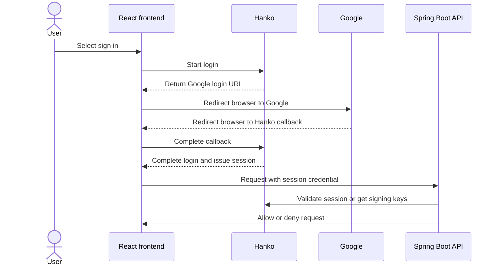

# Hanko application authentication

Hanko is prepared for the Disease Prediction app. Use this guide to integrate
app login and operate the service.

## App integration

The development frontend uses Hanko Elements for sign-in and sends a Hanko
session token to the backend as a bearer token. The development API checks
the token and session before providing patient data. The production app uses
older images; its authentication rollout and production registration are not
complete. Keep Argo CD and Grafana protected by Authelia.

Dev registration requires email verification. Development accounts created
before verification was enabled were deleted during the development reset. See
[Google and email sign-in](#google-and-email-sign-in) for the browser test and
production release gate. Other browser tests remain pending.

### Reset development users

Use this procedure only for an approved reset of all development test accounts.
It also deletes development patient profiles and consent history. It does not
target production. Hanko backups can contain deleted accounts and are subject
to a seven-day lifecycle rule. Check the separate retention of any app database
backups. Do not restore a pre-reset backup into the live database without
reviewing the risk of restoring untrusted credentials.

1. Stop the development Hanko and backend Deployments through a reviewed GitOps
   change. Confirm both have zero replicas and no running Pods. Keep them stopped
   until both reset Jobs complete and their results are checked.
   Verify a recent Hanko backup and restore using the matching dev encryption key.
   Create and verify an [encrypted app database backup](dev-app-backup.md).
2. From the GitOps repository root, preview both manual operation manifests:

   ```bash
   kubectl --context oracle-k3s apply --dry-run=server -f operations/hanko/reset-dev-app-users.yaml
   kubectl --context oracle-k3s apply --dry-run=server -f operations/hanko/reset-dev-users.yaml
   ```

   Each Job uses a development database role and rejects another database or
   role. Both Jobs use verified database TLS. The Hanko Job preserves signing
   keys, tenant configuration, and database migrations. It clears active flows
   and WebAuthn sessions as well as account data. The app Job removes users and
   their dependent profiles and consent history.
3. Run and check each Job in order:

   ```bash
   kubectl --context oracle-k3s apply -f operations/hanko/reset-dev-app-users.yaml
   kubectl --context oracle-k3s -n disease-prediction wait --for=condition=complete job/dev-user-reset --timeout=180s
   kubectl --context oracle-k3s -n disease-prediction logs job/dev-user-reset
   kubectl --context oracle-k3s apply -f operations/hanko/reset-dev-users.yaml
   kubectl --context oracle-k3s -n auth-system wait --for=condition=complete job/hanko-dev-user-reset --timeout=180s
   kubectl --context oracle-k3s -n auth-system logs job/hanko-dev-user-reset
   ```

   If either Job fails, keep both Deployments stopped. Inspect the Job before
   retrying; the two databases cannot be reset in a single transaction. Confirm
   that both databases contain zero users and that the Hanko signing key remains.
4. Remove both Jobs and their temporary NetworkPolicies:

   ```bash
   kubectl --context oracle-k3s delete -f operations/hanko/reset-dev-app-users.yaml
   kubectl --context oracle-k3s delete -f operations/hanko/reset-dev-users.yaml
   ```

   Restore the development replicas through a reviewed GitOps change.

### Remove the old development quarantine secret

After the approved reset, verify that both databases contain zero users before
deploying the change that removes the quarantine mount and configuration. Do
not restore pre-reset accounts with untrusted credentials into the live database.
The backend retains its optional quarantine feature for future incidents.

1. Wait for the backend to roll out without the quarantine mount. From the
   GitOps repository root on the operator machine, refresh `oci-vault-store`:

   ```bash
   kubectl --context oracle-k3s -n disease-prediction rollout status deployment/backend
   git fetch origin main
   git rev-parse origin/main
   date -u +%Y-%m-%dT%H:%M:%SZ
   kubectl --context oracle-k3s -n argocd annotate application oci-vault-store argocd.argoproj.io/refresh=hard --overwrite
   kubectl --context oracle-k3s -n argocd get application oci-vault-store -o json | jq '{refresh: .metadata.annotations["argocd.argoproj.io/refresh"], reconciledAt: .status.reconciledAt, revision: .status.sync.revision, quarantine: [.status.resources[]? | select(.kind == "ExternalSecret" and .name == "hanko-dev-quarantine") | .requiresPruning]}'
   ```

   Wait until Argo CD clears the refresh annotation, `reconciledAt` is later
   than the refresh request, and `revision` matches the `origin/main` commit.
   Repeat the final command as needed. The quarantine list must be empty or
   contain only `true`, meaning Argo CD considers the old resource eligible for
   pruning. Do not delete it while Argo CD still desires it: an old revision
   can recreate it.
2. Delete the old ExternalSecret and any retained Kubernetes Secret. Argo CD
   does not prune the ExternalSecret. Its owner reference normally removes the
   Secret; the second command also handles a Secret left behind.

   ```bash
   kubectl --context oracle-k3s -n disease-prediction delete externalsecret hanko-dev-quarantine --ignore-not-found
   kubectl --context oracle-k3s -n disease-prediction delete secret hanko-dev-quarantine --ignore-not-found
   ```

3. Refresh `oci-vault-store` again as in step 1. Wait for it to reconcile the
   current `origin/main` revision, then confirm both objects stay absent:

   ```bash
   kubectl --context oracle-k3s -n disease-prediction get externalsecret hanko-dev-quarantine --ignore-not-found -o name
   kubectl --context oracle-k3s -n disease-prediction get secret hanko-dev-quarantine --ignore-not-found -o name
   ```

In OCI Console, open the project Vault and select the secret named
`hanko-dev-quarantine`. Confirm its name and schedule deletion of that secret.
Do not delete the Vault or its encryption keys. A secret pending deletion cannot
be used; cancel its scheduled deletion in the Console if recovery is needed.
Oracle schedules deletion after 30 days by default and allows a shorter period.
Do not print or copy the secret contents.

### Login flow



The browser sends the session token to the app API. Hanko's session cookie is
not sent from the identity hostname to the app hostname.

### Values for each environment

| Value | Dev | Production |
|---|---|---|
| App origin | `https://dev.pocket-doc.app` | `https://health.pocket-doc.app` |
| Hanko public API and token issuer | `https://identity-dev.pocket-doc.app` | `https://identity.pocket-doc.app` |
| JSON Web Key Set (JWKS) | `https://identity-dev.pocket-doc.app/.well-known/jwks.json` | `https://identity.pocket-doc.app/.well-known/jwks.json` |
| Token audience | `pocket-doc-dev` | `pocket-doc-prod` |
| Hanko API inside Oracle K3s | `http://hanko-dev.auth-system.svc.cluster.local:8000` | `http://hanko-prod.auth-system.svc.cluster.local:8000` |
| Google callback | `https://identity-dev.pocket-doc.app/thirdparty/callback` | `https://identity.pocket-doc.app/thirdparty/callback` |

Use the values from the same column together. The public URLs and audience are
not secrets. The Google client secret stays in OCI Vault and Hanko; the app
does not need it. Cluster URLs are for the matching backend pod only. They use
HTTP inside the cluster and rely on the cluster network boundary.

### Frontend and backend configuration

The dev and production Dockerfiles build the frontend with their respective
`VITE_HANKO_API_URL` values. This value is embedded in the browser bundle: use
the matching image for the environment and rebuild to change it. It is public,
not a credential. The backend receives its issuer, audience, JWKS URL, and
Hanko API URL at runtime from the matching GitOps `config.env` file.

The Hanko SDK stores the bearer token in a JavaScript-readable cookie on the
app origin. Injected scripts can read it. The backend validates the JWT
signature, issuer, audience and expiry, then checks the session with Hanko.
Session validation results are cached for 60 seconds; cached active sessions can
remain usable during that interval after revocation or a Hanko outage.

Dev allows `https://dev.pocket-doc.app` and `http://localhost:5173` as browser
origins. Passkeys require `https://dev.pocket-doc.app`; localhost is not a
configured WebAuthn origin. Production only allows
`https://health.pocket-doc.app`. Google success redirects also allow the app
`/login` path. Update the allowed origins and redirects when adding a login
origin or page.

See the frontend and backend repository READMEs for the current implementation
and local setup. Test the matching image, Hanko instance and backend settings
together; changing one image does not automatically select the other values.

### Google and email sign-in

Both environments disable automatic Google account linking. A development browser
test on 16 November 2026 confirmed that a user can create an account with Google,
then sign in with an email passcode using the same address and open the same app
profile. Selecting **Create account** with an address already in use is expected
to send an account-exists notice; this path has not been tested in the browser.
Hanko treats Gmail plus addresses as distinct addresses.

An email-created account cannot be linked to Google while `allow_linking` is
false. Hanko v3.1 applies this setting to both automatic linking and the profile
connection flow. Keep it disabled until a tested flow proves control of both
credentials before linking. Do not merge accounts based on email address alone.

Google's `email_verified` claim may not prove current ownership of an address
outside Gmail and Google Workspace. Hanko's built-in Google provider accepts
that claim when creating an account, and email-passcode login can use the same
address. A new mailbox owner could gain access to a Google-created account. Before
using Google for production patients, resolve this with a tested mailbox ownership
check or disable the production Google provider. See [Google's email ownership
guidance](https://developers.google.com/identity/sign-in/web/backend-auth) and
[Hanko v3.1 account linking](https://github.com/teamhanko/hanko/blob/backend/v3.1.0/backend/thirdparty/linking.go).

### Before enabling registration in production

Complete these checks before enabling signup in production:

1. Review the frontend session flow and backend authorization and deploy the intended production images.
2. Confirm production email delivery and complete Google's production
   requirements. Test Google sign-in with an authorized account. Production
   signup and automatic account linking are disabled, so use dev or a suitable
   existing linked test account.
3. Test login, logout, expired and revoked sessions, invalid issuer and
   audience, cross-environment tokens, and access to another user's data.
   Check rate limits under expected traffic.
4. After those checks, DevOps can enable `account.allow_signup` for the intended
   environment through GitOps. Keep Argo CD and Grafana protected by Authelia.

## Service operation

The instances use separate databases, database roles, signing-key encryption
keys, origins, and token audiences. One PostgreSQL 18 server in `auth-system`
serves both databases on a 2 GiB `local-path` volume. PostgreSQL requires TLS;
Hanko verifies the database certificate and hostname. This is one database
server on one Oracle node, without automatic failover. A daily CronJob dumps
both databases to a private OCI Object Storage bucket. OCI encrypts objects at
rest and removes them after seven days. Retain the matching Vault encryption keys;
losing them prevents Hanko from using its stored signing keys. See
[Backup and restore](#backup-and-restore).

Only port 8000 is exposed through a ClusterIP Service and the Cloudflare
Tunnel. NetworkPolicies allow Traefik and the matching app backend to reach
that port. The unauthenticated admin API on port 8001 has no Service or public
route. Do not expose it. An operator with Kubernetes `pods/portforward` access
can use a private port-forward for maintenance.

Development uses `hanko-smtp-dev` and sends from
`no-reply@mail-dev.pocket-doc.app`. Production uses `hanko-smtp-prod` and sends
from `no-reply@mail.pocket-doc.app`. Both use OCI Email Delivery. Keep the
previous `hanko-smtp` Vault secret for rollback. To roll back production,
restore its Deployment SMTP references to `hanko-smtp` in a reviewed Git
change and verify the rollout. Confirm that mailbox headers show DKIM and DMARC
passing for each sender before opening registration. See the infrastructure
email delivery guide for DNS, quotas and credential rotation.

Hanko uses an in-memory rate limiter and accepts forwarded client IP addresses
only from the cluster Pod network, which
matches Traefik's trusted proxy range. NetworkPolicy limits access to Traefik
and the matching backend. The Cloudflare Tunnel and Traefik path was checked
with a forged forwarding header. Repeat that check after changes to either
proxy or the Pod network. Hanko does not store the session IP address.

### Development request limits

Traefik limits `POST /registration`, `POST /login`, and `POST /profile` on
the development Hanko route. The client limit uses Cloudflare's
`CF-Connecting-IP` header, with an average of 40 requests per minute and a
burst of 20. A second limit uses the request hostname, with an average of 300
requests per minute and a burst of 60. The token buckets refill continuously.
Google callbacks, preflight requests, and the production route do not use
these limits. For the dev app and local dev origins, Traefik adds cross-origin
headers to its rate-limit responses so the browser can read the HTTP 429 status.
Keep these origins in sync with the dev Hanko CORS configuration.

The web entry point must only receive Cloudflare Tunnel traffic. With one
external client, a temporary probe confirmed that Cloudflare's client IP
matched its trace, a forged `X-Forwarded-For` prefix did not change Hanko's
resolved address, and forged `CF-Connecting-IP` requests were rejected.
This does not prove every network path or future Cloudflare configuration.
To repeat the check from the GitOps repository root, apply the temporary
resources, wait for the pod and route, run the checker, then remove them:

```bash
kubectl --context oracle-k3s apply -f tests/hanko/forwarded-headers-probe.yaml
kubectl --context oracle-k3s -n auth-system wait --for=condition=Ready pod/hanko-forwarded-headers-probe --timeout=120s
kubectl --context oracle-k3s -n auth-system describe httproute hanko-forwarded-headers-probe
python3 tests/hanko/check-forwarded-headers.py
kubectl --context oracle-k3s delete -f tests/hanko/forwarded-headers-probe.yaml
```

Confirm that the route reports `Accepted` and `ResolvedRefs` as `True`. Allow
time for routing to propagate before running the checker. Remove the resources
even if a check fails. The exact probe path is publicly reachable while the
resources exist; it returns the caller's forwarding headers without logging
requests.

The Traefik and Hanko counters are in memory and reset on restart. Separate
routers or replicas can have separate buckets. These limits do not enforce a
per-recipient cap, and different IPv6 addresses can use different buckets.
They are not a billing cap. Configure OCI Email Delivery quotas and alerts
before relying on managed email to bound total sending.

## Secrets

OCI Vault stores these JSON secrets. External Secrets Operator (ESO) copies
selected fields into `auth-system` Kubernetes Secrets. Do not print the values
or put them in Git, Terraform state, shell arguments, or logs.

| OCI secret | Fields |
|---|---|
| `hanko-runtime` | `pg_admin_password`, `dev_db_password`, `prod_db_password`, `dev_encryption_key`, `prod_encryption_key` |
| `hanko-postgres-tls` | `ca_cert`, `server_cert`, `server_key` |
| `hanko-smtp`, `hanko-smtp-dev`, `hanko-smtp-prod` | `host`, `port`, `username`, `password`, `from_address` |
| `hanko-google-dev`, `hanko-google-prod` | Google client JSON: `web.client_id`, `web.client_secret` |
| `hanko-backup-upload` | `url`: the write-only preauthenticated Object Storage URL |

The PostgreSQL certificate must contain
`hanko-postgres.auth-system.svc.cluster.local` as a DNS subject alternative
name. Keep its private key in Vault. Renew it before expiry. Rotate the CA by
first distributing a trust bundle containing both old and new CAs; switch the
server certificate, restart the clients, then remove the old CA after checking
all connections. Coordinate database password changes with PostgreSQL role
updates; changing the Vault value alone does not update an existing role.
Hanko signing-key rotation needs the old encryption key until its old signing
keys and sessions are retired. Follow the upstream key rotation procedure;
do not replace the key blindly.

## Preview and deploy

From the GitOps repository root, render and review the change:

```bash
kubectl kustomize clusters/oracle/auth/hanko
kubectl kustomize clusters/oracle/external-secrets/auth-system
kubectl kustomize clusters/oracle
kubectl --context oracle-k3s diff -k clusters/oracle/auth/hanko
```

Create the Vault secrets with the required values before deployment. Merge the
reviewed change into `main`; Argo CD synchronizes the `hanko` Application and
`oci-auth-vault-store`. From a workstation with private cluster access, check:

```bash
kubectl --context oracle-k3s -n argocd get application hanko oci-auth-vault-store
kubectl --context oracle-k3s -n auth-system get externalsecret hanko-dev hanko-prod hanko-google-dev hanko-google-prod hanko-postgres hanko-postgres-tls hanko-postgres-ca hanko-smtp hanko-smtp-dev hanko-smtp-prod hanko-backup-upload
kubectl --context oracle-k3s -n auth-system get deployments,pods,services,pvc
kubectl --context oracle-k3s -n auth-system get httproute hanko-dev hanko-prod
kubectl --context oracle-k3s -n auth-system top pods --containers
```

To check the OCI SMTP credentials from the cluster without sending mail, run
the temporary checks from the repository root, then remove them:

```bash
kubectl --context oracle-k3s apply -f tests/hanko/smtp-oci-check.yaml
kubectl --context oracle-k3s -n auth-system wait --for=jsonpath='{.status.phase}'=Succeeded pod/oci-smtp-prod-check --timeout=90s
kubectl --context oracle-k3s -n auth-system logs pod/oci-smtp-prod-check
kubectl --context oracle-k3s delete -f tests/hanko/smtp-oci-check.yaml
```

The manifest also checks the development and infrastructure OCI credentials.
This test checks authentication only; it does not send email. The separate
`tests/hanko/smtp-oci-send-prod-check.yaml` sends one message to the configured
check mailbox. Run it only when the mailbox owner expects a test. Check the
received message's DKIM and DMARC results, then delete the Pod.

To check that each app namespace reaches only its own Hanko service, run:

```bash
kubectl --context oracle-k3s apply -f tests/hanko/network-check.yaml
kubectl --context oracle-k3s -n disease-prediction wait --for=jsonpath='{.status.phase}'=Succeeded pod/hanko-network-check --timeout=90s
kubectl --context oracle-k3s -n disease-prediction-prod wait --for=jsonpath='{.status.phase}'=Succeeded pod/hanko-network-check --timeout=90s
kubectl --context oracle-k3s -n disease-prediction logs pod/hanko-network-check
kubectl --context oracle-k3s -n disease-prediction-prod logs pod/hanko-network-check
kubectl --context oracle-k3s delete -f tests/hanko/network-check.yaml
```

The ExternalSecrets and deployments must be ready. Check that both HTTPRoutes
have `Accepted=True` and `ResolvedRefs=True`, then check their health and keys:

```bash
curl --fail https://identity-dev.pocket-doc.app/health/ready
curl --fail https://identity-dev.pocket-doc.app/.well-known/jwks.json
curl --fail https://identity.pocket-doc.app/health/ready
curl --fail https://identity.pocket-doc.app/.well-known/jwks.json
```

## Backup and restore

The `hanko-backup` CronJob runs daily at 02:17 UTC. It connects to both
databases with their respective roles and verified PostgreSQL TLS. OCI Object Storage encrypts the backups at
rest. The private `disease-prediction-hanko-backups` bucket expires objects
after seven days. It shares the tenancy's 20 GB Object Storage quota with the
Terraform state bucket; monitor usage. The temporary dump uses up to 3 GiB on
the Oracle node. The upload process removes the dump files. Kubernetes keeps
the latest two successful jobs and three failed jobs for review, then removes
older jobs and their pods. Check failed job logs before they age out of that
history.

The upload URL is a write-only preauthenticated request for the `hanko/`
prefix. It cannot list or read backups. It expires on 14 November 2027. Before
expiry, create another request with the same prefix and permissions in OCI,
replace the `url` field in the `hanko-backup-upload` Vault secret, wait for
ESO, run the backup check, and revoke the old request. Never print the URL.

To check the latest scheduled job and recent backups:

```bash
kubectl --context oracle-k3s -n auth-system get cronjob hanko-backup
kubectl --context oracle-k3s -n auth-system get jobs -l app.kubernetes.io/name=hanko-backup
oci os object list --bucket-name disease-prediction-hanko-backups --prefix hanko/
```

The Proxmox Prometheus rule `HankoBackupStale` alerts if there has been no
successful scheduled backup for 36 hours. Check the existing Alertmanager
notification setup separately; the rule alone does not configure delivery.

To run a one-off backup check from the GitOps repository root, first compare
the versioned job's pod template with the live CronJob. The backup volume must
be writable in both dump and upload containers. A manual job does not update
the CronJob's last successful time; also check the next scheduled run.

```bash
kubectl --context oracle-k3s -n auth-system create job hanko-backup-preview --from=cronjob/hanko-backup --dry-run=client -o yaml
kubectl --context oracle-k3s apply -f tests/hanko/backup-check.yaml
kubectl --context oracle-k3s -n auth-system wait --for=condition=complete job/hanko-backup-check --timeout=180s
kubectl --context oracle-k3s -n auth-system logs job/hanko-backup-check -c upload
kubectl --context oracle-k3s delete -f tests/hanko/backup-check.yaml
```

For a restore, download the matching environment's dump to protected temporary
storage from the private bucket. Restore it into a new, isolated PostgreSQL 18
database with `pg_restore --no-owner --no-acl --exit-on-error`. Connect a test
Hanko instance using that environment's matching `hanko-runtime` encryption key
and version. Verify its public keys, user data, and login before considering a
production cutover. Remove the temporary copy and test instance afterward.
Keep an encrypted offline copy of the Vault values needed to recover the
signing keys. A bucket backup cannot recover a deleted Vault or its keys by
itself.

## Change and removal

To cancel development registration flows started under the old demo settings,
use the [development flow expiry procedure](hanko-flow-expiry.md).

Change `hanko-dev-config.yaml` or `hanko-prod-config.yaml` in
`clusters/oracle/auth/hanko`, preview and merge through a pull request, then
check Argo CD and both services. A ConfigMap change rolls out the matching
Deployment. Each replacement pod runs the Hanko migration init container.
Check compatibility between the old and new versions before changing the
Hanko image. During the overlap, each pod has its own in-memory rate limiter.
After the rollout, remove the old ConfigMap as described in the
[application operations guide](disease-prediction.md#remove-old-generated-configmaps).

Secret changes do not automatically restart pods. After the ExternalSecret is
ready, restart the affected Hanko Deployment and check the rollout. When
rotating a Google client, keep the old client valid until the new one works.

Before deleting data, verify an off-node backup can be restored with its
matching Vault keys. Remove the Hanko Application and resources in a reviewed
Git change. Argo CD pruning is disabled, so explicitly delete the old
resources after the change. Retain the PVC, bucket, and Vault secrets until
recovery is no longer needed. ExternalDNS is upsert-only; remove the Hanko DNS
and TXT ownership records manually after confirming their owner. Never delete
Authelia resources as part of Hanko removal. The bucket has a Terraform
`prevent_destroy` guard; follow the infrastructure guide before removing it.

See the [public route guide](domain-ingress.md), [secret operations](secrets.md),
[Hanko backend configuration](https://github.com/teamhanko/hanko/blob/backend/v3.1.0/backend/README.md),
and [Hanko frontend components](https://github.com/teamhanko/hanko/tree/main/frontend/elements).
