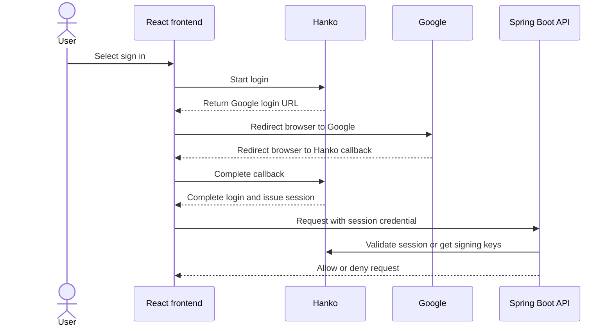

# Hanko application authentication

Hanko is prepared for the Disease Prediction app. Use this guide to integrate
app login and operate the service.

## Handoff for the app team

The app does not use Hanko yet. Both app routes and their proxied APIs are
public. Registration is disabled in both Hanko instances. Google is configured,
but a complete Google sign-in has not been tested.

### How login will work



The session credential path is not implemented. The frontend and API teams
must choose and implement it together.

### Values for each environment

| Value | Dev | Production |
|---|---|---|
| App origin | `https://dev.pocket-doc.app` | `https://health.pocket-doc.app` |
| Hanko public API and token issuer | `https://identity-dev.pocket-doc.app` | `https://identity.pocket-doc.app` |
| JSON Web Key Set (JWKS) | `https://identity-dev.pocket-doc.app/.well-known/jwks.json` | `https://identity.pocket-doc.app/.well-known/jwks.json` |
| Token audience | `pocket-doc-dev` | `pocket-doc-prod` |
| Hanko API inside Oracle K3s | `http://hanko-dev.auth-system.svc.cluster.local:8000` | `http://hanko-prod.auth-system.svc.cluster.local:8000` |
| Google callback | `https://identity-dev.pocket-doc.app/thirdparty/callback` | `https://identity.pocket-doc.app/thirdparty/callback` |

Use the values from the same column together. The public URLs and audience are
not secrets. The Google client secret stays in OCI Vault and Hanko; the app
does not need it. Cluster URLs are for the matching backend pod only. They use
HTTP inside the cluster and rely on the cluster network boundary.

### Frontend: React and Vite

1. In the frontend repository, install Hanko Elements and use the matching
   public Hanko API URL. Follow the [Hanko React guide](https://docs.hanko.io/quickstarts/frontend/react)
   for component registration, session events, and logout. The project already
   uses React Router.
2. Add a login page with the Hanko authentication component. Handle successful
   login, errors, expired sessions, and logout. Google is a Hanko provider; the
   frontend must not receive the Google client secret.
3. Agree with the backend team on how API requests carry a session. Implement
   and test the chosen approach before treating any frontend route as protected.
4. Pass the Hanko API URL into the Vite build for each environment. The current
   frontend build does not yet define a Hanko environment variable; add one to
   the frontend build and deployment workflow.

Run this command in the frontend repository when starting the integration:

```bash
npm install @teamhanko/hanko-elements
```

For example, the team can introduce `VITE_HANKO_API_URL` and set it to
`https://identity-dev.pocket-doc.app` for dev. Vite embeds `VITE_` values in
the browser bundle at build time. Update the image build arguments and CI for
both environments; do not put secrets in these values.

Dev Hanko allows `https://dev.pocket-doc.app` and `http://localhost:5173` as
browser origins. Passkeys require `https://dev.pocket-doc.app`; localhost is not
configured as a WebAuthn origin. Production only allows
`https://health.pocket-doc.app`. Ask DevOps to update the allowed origins and
Google success/error redirects when the team chooses a different login URL.
Current Google redirects point to the app origins; dev also allows localhost as
a success redirect.

### Session handoff: agree before implementation

Hanko issues a session JSON Web Token (JWT) that expires after 15 minutes. Its
cookie is `Secure`, `HttpOnly`, `SameSite=Lax`, and host-only: the browser will not send an
identity-host cookie to the app hostname or its `/api/` proxy. Hanko is also
configured to return `X-Auth-Token` after authentication. This does not by
itself connect the session to the API.

The teams must choose and review how a session reaches the backend, including
Google redirect completion, page reload, expiry, logout, token storage, and
cross-site request forgery (CSRF) protection where cookies are used. For a
bearer-token design, send the token in `Authorization: Bearer <token>` and
verify the complete token lifecycle; do not put tokens in URLs or logs. Check
browser cookie restrictions for local development. No session transport has
been implemented or verified in the app.

### Backend: Java and Spring Boot

1. Protect the API on the server. Frontend route checks alone do not protect
   `/api/assessments` or user data. Update the OpenAPI contract in
   `src/main/resources/openapi/` when the API's authentication requirements or
   responses change.
2. If using JWT validation, configure the matching JWKS, issuer, and audience
   from the table above. Check the signature, allowed signing algorithm,
   expiry, issuer, and audience. Hanko does not expose OpenID Connect discovery;
   provide the JWKS URL explicitly. The backend does not have Spring Security
   or this validation configured today.
3. Use the verified `sub` claim as the Hanko user identifier. Map it to the
   app's own patient records and check access for each request. Do not trust a
   `patientId` supplied by the browser as proof of ownership.
4. Decide whether logout and revocation must take effect immediately. Offline
   JWT validation alone can accept a revoked token until it expires. For an
   immediate check, send `POST /sessions/validate` to the matching Hanko API
   with JSON `{"session_token": "<token>"}`. Check `is_valid` and deny access
   when validation fails or is unavailable. Never log session tokens.

For a bearer-token design, Spring Boot's resource server can validate JWTs.
The following is a **dev example to add during implementation**; it does not
configure endpoint rules, transport, or session revocation:

```yaml
spring:
  security:
    oauth2:
      resourceserver:
        jwt:
          issuer-uri: https://identity-dev.pocket-doc.app
          jwk-set-uri: https://identity-dev.pocket-doc.app/.well-known/jwks.json
          audiences:
            - pocket-doc-dev
```

Add the required Spring Security resource-server dependencies and security
rules. Use the production values for production. See [Spring Boot resource
server configuration](https://docs.spring.io/spring-boot/reference/security/oauth2.html)
and [Spring Security JWT validation](https://docs.spring.io/spring-security/reference/servlet/oauth2/resource-server/jwt.html).

### Before enabling registration

1. Implement and review the frontend session flow and backend authorization.
2. Configure production email delivery and complete Google's production
   requirements. Test Google sign-in with an authorized account. Signup and
   automatic account linking are disabled, so use a suitable existing linked
   test account or an isolated test instance with signup enabled.
3. Test login, logout, expired and revoked sessions, invalid issuer and
   audience, cross-environment tokens, and access to another user's data.
   Check rate limits under expected traffic.
4. After those checks, DevOps can enable `account.allow_signup` for the intended
   environment through GitOps. Keep Argo CD and Grafana protected by Authelia.

## Service operation

The instances use separate databases, database roles, signing-key encryption
keys, origins, and token audiences. One PostgreSQL 18 server in `auth-system`
serves both databases on a 2 GiB `local-path` volume. PostgreSQL requires TLS;
Hanko verifies the database certificate and hostname. This is one database
server on one Oracle node, without automatic failover. A daily CronJob dumps
both databases to a private OCI Object Storage bucket. OCI encrypts objects at
rest and removes them after seven days. Retain the matching Vault encryption keys;
losing them prevents Hanko from using its stored signing keys. See
[Backup and restore](#backup-and-restore).

Only port 8000 is exposed through a ClusterIP Service and the Cloudflare
Tunnel. NetworkPolicies allow Traefik and the matching app backend to reach
that port. The unauthenticated admin API on port 8001 has no Service or public
route. Do not expose it. An operator with Kubernetes `pods/portforward` access
can use a private port-forward for maintenance.

The instances use the current Authelia SMTP account via a separate OCI Vault
secret. The Hanko secret is a copy, not an automatic sync from Authelia; update
it when the SMTP credentials change. Hanko uses an in-memory rate limiter and
accepts forwarded client IP addresses only from the cluster Pod network, which
matches Traefik's trusted proxy range. NetworkPolicy limits access to Traefik
and the matching backend. The Cloudflare Tunnel and Traefik path was checked
with a forged forwarding header. Repeat that check after changes to either
proxy or the Pod network. Hanko does not store the session IP address.

## Secrets

OCI Vault stores these JSON secrets. External Secrets Operator (ESO) copies
selected fields into `auth-system` Kubernetes Secrets. Do not print the values
or put them in Git, Terraform state, shell arguments, or logs.

| OCI secret | Fields |
|---|---|
| `hanko-runtime` | `pg_admin_password`, `dev_db_password`, `prod_db_password`, `dev_encryption_key`, `prod_encryption_key` |
| `hanko-postgres-tls` | `ca_cert`, `server_cert`, `server_key` |
| `hanko-smtp` | `host`, `port`, `username`, `password`, `from_address` |
| `hanko-google-dev`, `hanko-google-prod` | Google client JSON: `web.client_id`, `web.client_secret` |
| `hanko-backup-upload` | `url`: the write-only preauthenticated Object Storage URL |

The PostgreSQL certificate must contain
`hanko-postgres.auth-system.svc.cluster.local` as a DNS subject alternative
name. Keep its private key in Vault. Renew it before expiry. Rotate the CA by
first distributing a trust bundle containing both old and new CAs; switch the
server certificate, restart the clients, then remove the old CA after checking
all connections. Coordinate database password changes with PostgreSQL role
updates; changing the Vault value alone does not update an existing role.
Hanko signing-key rotation needs the old encryption key until its old signing
keys and sessions are retired. Follow the upstream key rotation procedure;
do not replace the key blindly.

## Preview and deploy

From the GitOps repository root, render and review the change:

```bash
kubectl kustomize clusters/oracle/auth/hanko
kubectl kustomize clusters/oracle/external-secrets/auth-system
kubectl kustomize clusters/oracle
kubectl --context oracle-k3s diff -k clusters/oracle/auth/hanko
```

Create the Vault secrets with the required values before deployment. Merge the
reviewed change into `main`; Argo CD synchronizes the `hanko` Application and
`oci-auth-vault-store`. From a workstation with private cluster access, check:

```bash
kubectl --context oracle-k3s -n argocd get application hanko oci-auth-vault-store
kubectl --context oracle-k3s -n auth-system get externalsecret hanko-dev hanko-prod hanko-google-dev hanko-google-prod hanko-postgres hanko-postgres-tls hanko-postgres-ca hanko-smtp hanko-backup-upload
kubectl --context oracle-k3s -n auth-system get deployments,pods,services,pvc
kubectl --context oracle-k3s -n auth-system get httproute hanko-dev hanko-prod
kubectl --context oracle-k3s -n auth-system top pods --containers
```

To check SMTP authentication from the cluster without sending mail, run the
temporary check from the repository root, then remove it:

```bash
kubectl --context oracle-k3s apply -f tests/hanko/smtp-check.yaml
kubectl --context oracle-k3s -n auth-system wait --for=jsonpath='{.status.phase}'=Succeeded pod/hanko-smtp-check --timeout=90s
kubectl --context oracle-k3s -n auth-system logs pod/hanko-smtp-check
kubectl --context oracle-k3s delete -f tests/hanko/smtp-check.yaml
```

To check that each app namespace reaches only its own Hanko service, run:

```bash
kubectl --context oracle-k3s apply -f tests/hanko/network-check.yaml
kubectl --context oracle-k3s -n disease-prediction wait --for=jsonpath='{.status.phase}'=Succeeded pod/hanko-network-check --timeout=90s
kubectl --context oracle-k3s -n disease-prediction-prod wait --for=jsonpath='{.status.phase}'=Succeeded pod/hanko-network-check --timeout=90s
kubectl --context oracle-k3s -n disease-prediction logs pod/hanko-network-check
kubectl --context oracle-k3s -n disease-prediction-prod logs pod/hanko-network-check
kubectl --context oracle-k3s delete -f tests/hanko/network-check.yaml
```

The ExternalSecrets and deployments must be ready. Check that both HTTPRoutes
have `Accepted=True` and `ResolvedRefs=True`, then check their health and keys:

```bash
curl --fail https://identity-dev.pocket-doc.app/health/ready
curl --fail https://identity-dev.pocket-doc.app/.well-known/jwks.json
curl --fail https://identity.pocket-doc.app/health/ready
curl --fail https://identity.pocket-doc.app/.well-known/jwks.json
```

## Backup and restore

The `hanko-backup` CronJob runs daily at 02:17 UTC. It connects to both
databases with their respective roles and verified PostgreSQL TLS. OCI Object Storage encrypts the backups at
rest. The private `disease-prediction-hanko-backups` bucket expires objects
after seven days. It shares the tenancy's 20 GB Object Storage quota with the
Terraform state bucket; monitor usage. The temporary dump uses up to 3 GiB on
the Oracle node. The upload process removes the dump files, and finished job
pods are deleted after one hour.

The upload URL is a write-only preauthenticated request for the `hanko/`
prefix. It cannot list or read backups. It expires on 14 November 2027. Before
expiry, create another request with the same prefix and permissions in OCI,
replace the `url` field in the `hanko-backup-upload` Vault secret, wait for
ESO, run the backup check, and revoke the old request. Never print the URL.

To check the latest scheduled job and recent backups:

```bash
kubectl --context oracle-k3s -n auth-system get cronjob hanko-backup
kubectl --context oracle-k3s -n auth-system get jobs -l app.kubernetes.io/name=hanko-backup
oci os object list --bucket-name disease-prediction-hanko-backups --prefix hanko/
```

The Proxmox Prometheus rule `HankoBackupStale` alerts if there has been no
successful scheduled backup for 36 hours. Check the existing Alertmanager
notification setup separately; the rule alone does not configure delivery.

To run a one-off backup check from the GitOps repository root:

```bash
kubectl --context oracle-k3s apply -f tests/hanko/backup-check.yaml
kubectl --context oracle-k3s -n auth-system wait --for=condition=complete job/hanko-backup-check --timeout=180s
kubectl --context oracle-k3s -n auth-system logs job/hanko-backup-check -c upload
kubectl --context oracle-k3s delete -f tests/hanko/backup-check.yaml
```

For a restore, download the matching environment's dump to protected temporary
storage from the private bucket. Restore it into a new, isolated PostgreSQL 18
database with `pg_restore --no-owner --no-acl --exit-on-error`. Connect a test
Hanko instance using that environment's matching `hanko-runtime` encryption key
and version. Verify its public keys, user data, and login before considering a
production cutover. Remove the temporary copy and test instance afterward.
Keep an encrypted offline copy of the Vault values needed to recover the
signing keys. A bucket backup cannot recover a deleted Vault or its keys by
itself.

## Change and removal

Make configuration changes in `clusters/oracle/auth/hanko`, preview and merge
through a pull request, then check Argo CD and both services. ConfigMap and
Secret changes do not automatically restart pods. After the ExternalSecret is
ready, restart the affected Hanko Deployment and check the rollout. When
rotating a Google client, keep the old client valid until the new one works.

Before deleting data, verify an off-node backup can be restored with its
matching Vault keys. Remove the Hanko Application and resources in a reviewed
Git change. Argo CD pruning is disabled, so explicitly delete the old
resources after the change. Retain the PVC, bucket, and Vault secrets until
recovery is no longer needed. ExternalDNS is upsert-only; remove the Hanko DNS
and TXT ownership records manually after confirming their owner. Never delete
Authelia resources as part of Hanko removal. The bucket has a Terraform
`prevent_destroy` guard; follow the infrastructure guide before removing it.

See the [public route guide](domain-ingress.md), [secret operations](secrets.md),
[Hanko backend configuration](https://github.com/teamhanko/hanko/blob/backend/v3.1.0/backend/README.md),
and [Hanko frontend components](https://github.com/teamhanko/hanko/tree/main/frontend/elements).
