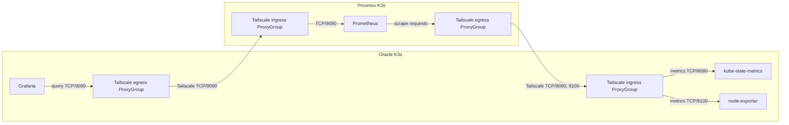

# Prometheus and Grafana

Each cluster has a `monitoring` Argo CD Application using kube-prometheus-stack
92.17.0. Oracle runs Grafana, kube-state-metrics, and node-exporter. It has no
Prometheus server or Prometheus Operator. Proxmox runs Prometheus,
Alertmanager, the operator, kube-state-metrics, and node-exporter with Grafana
disabled. Proxmox Prometheus scrapes Oracle's two metric exporters through
Tailscale. Oracle Grafana queries that shared Prometheus endpoint through its
existing Tailscale egress Service. The Proxmox values are in
[`clusters/proxmox/observability/values.yaml`](../../clusters/proxmox/observability/values.yaml)
and its Application is in
[`clusters/proxmox/applications/observability.yaml`](../../clusters/proxmox/applications/observability.yaml).
Oracle's chart values remain in [`clusters/oracle/observability/values.yaml`](../../clusters/oracle/observability/values.yaml).

Oracle's Prometheus data plane has been retired. Its old 10 GiB Prometheus PVC,
PV, and metrics history were deleted; physical disk use before deletion was
not measured. Oracle now runs only the exporters needed for cluster health:
kube-state-metrics reports nodes and Kubernetes objects, and node-exporter
reports host CPU, memory, disk, and network usage. The Tailscale policy is
external to this repository. Follow the
[Tailscale guide](tailscale.md#connect-selected-kubernetes-services) to allow
Oracle Grafana to query Proxmox Prometheus on TCP/9090 and Proxmox Prometheus
to scrape Oracle's exporters on TCP/8080 and TCP/9100.



The Grafana sidecar imports the checked-in dashboards from ConfigMaps in
Oracle's `monitoring` namespace. **Kubernetes / Fleet Overview** shows both
clusters at a glance. **Kubernetes / Cluster Detail** filters by cluster,
namespace, and node for workload and capacity investigation. Both dashboards
put current status panels first, followed by normalized time series and
resource requests. There are no log or trace panels because this repository
does not run a log or trace collector. Oracle reports host-level CPU and
memory use, but does not expose per-container usage; container CPU and memory
metrics are available for Proxmox only.

Both `monitoring` namespaces enforce the Baseline Pod Security Standard.
Grafana's Oracle data-volume init container changes file ownership.
Node-exporter runs in a separate `node-exporter` namespace with Privileged
enforcement for its host filesystem access. It uses host networking and does
not use the host PID namespace.

Grafana uses native Authelia OIDC at `grafana.pocket-doc.app`. The `admins`
group gets the Grafana admin role; other signed-in users are Viewers. Local
password login is disabled. Its public route is managed by a separate
Application. Argo CD automatically syncs and self-heals both the monitoring
stack and its public route. Automatic pruning is disabled. The root
Application's sync waves order child Application creation but do not wait for
child health, so during a fresh bootstrap the route can be created before
Grafana and OIDC are ready. Do not rely on the wave as a readiness or
authentication gate.
See the [public route guide](domain-ingress.md) for route requirements.

Proxmox Prometheus keeps seven days of metrics, up to 8 GiB, on a 10 GiB local
volume. Oracle Grafana uses a 1 GiB local volume. The Oracle exporters add no
storage; their samples use Proxmox's existing retention limit. These data are
stored on their cluster nodes and are lost if the disk is lost. Traefik can
read Secrets in Oracle's `monitoring` namespace, including Grafana's OIDC
Secret. Grafana uses Traefik NativeLB because direct Pod IP connections failed
in this cluster.

Proxmox Prometheus scrapes the CloudNativePG exporter through the
cluster-local Service at `postgres-metrics.postgres.svc.cluster.local:9187`
every 60 seconds with the `proxmox-cnpg` job name. Check the target with
`up{job="proxmox-cnpg"}`. This collects database metrics, not logs; logs
remain on their cluster nodes until a separate log collector is configured.

Logs from Prometheus, Alertmanager, Grafana, and other monitoring pods use
Kubernetes pod logs on the node. Kubelet rotates them at 10 MiB and keeps up to
five files. A daily host timer deletes rotated pod logs older than seven days
across all namespaces, including `monitoring`. Active logs remain, and size
rotation can remove older entries sooner. There is no log collector, so logs
are only available on the node. This is separate from Prometheus metric
retention. See the [log retention guide](log-retention.md).

The local Grafana admin Secret is for recovery only. Do not commit it or use
it as the public login.

## Resource sizing

Before the move, Oracle Grafana used up to 434 MiB and Prometheus used up to
505 MiB.
Grafana's request is 384 MiB, close to its earlier 364 MiB p95; its 512 MiB
limit stays above the measured peak. Proxmox Prometheus uses a 512 MiB request
and a 1.5 GiB limit while data builds up to its full seven-day retention.

Before the move, peaks were 18 MiB for Alertmanager, 35 MiB for the operator,
36 MiB for kube-state-metrics, and 9 MiB for node-exporter. Proxmox uses
request/limit pairs of 32/64, 64/128, 48/96, and 16/32 MiB for those
components. Oracle uses the same 48/96 MiB kube-state-metrics and 16/32 MiB
node-exporter settings. The Oracle metrics ingress and Proxmox metrics egress
proxy each request 64 MiB. The Grafana dashboard sidecar peaked at 79 MiB, so
its 64/128 MiB settings stay. Requests reserve scheduler capacity; limits cap
use. Neither setting lowers a running process's current memory.

```bash
kubectl top pods -n monitoring --containers
kubectl top node
```

Use at least a seven-day sample before lowering the Prometheus or Grafana
limits. The node journal and rotated logs also have local retention rules; see
the [log retention guide](log-retention.md).

## Prepare and sync

The Proxmox stack needs no credentials. Oracle Grafana still needs its local
admin Secret and OIDC client Secret. If those are not already present, create
the local admin Secret with a unique password at the prompt:

```bash
set +x
password_file=$(mktemp)
chmod 600 "$password_file"
trap 'rm -f "$password_file"' EXIT
printf 'Grafana admin password: '
IFS= read -r -s grafana_admin_password
printf '\n'
printf '%s' "$grafana_admin_password" > "$password_file"
unset grafana_admin_password
kubectl -n monitoring create secret generic monitoring-grafana-admin \
  --from-literal=admin-user=admin \
  --from-file=admin-password="$password_file" \
  --dry-run=client -o yaml | kubectl apply -f -
```

The `monitoring` Application needs this Secret before Grafana can start. Create
the OIDC client secret pair in OCI Vault by following the
[Authelia guide](authelia.md#prepare-the-oci-vault-secrets). ESO syncs the
plaintext secret to `monitoring/grafana-oidc-client`. Never put it in Git. The
Grafana chart also uses the checked-in Origin CA bundle for its private OIDC
connection to Authelia. Before syncing, add the tailnet tags, service
auto-approver, and TCP/8080 and TCP/9100 grant from the
[Tailscale guide](tailscale.md#connect-selected-kubernetes-services). Render
the manifests and chart, then review the diff:

```bash
kubectl kustomize clusters/oracle > /dev/null
kubectl kustomize clusters/proxmox > /dev/null
helm template monitoring kube-prometheus-stack \
  --repo https://prometheus-community.github.io/helm-charts \
  --version 92.17.0 \
  --namespace monitoring \
  --values clusters/oracle/observability/values.yaml > /dev/null
helm template monitoring kube-prometheus-stack \
  --repo https://prometheus-community.github.io/helm-charts \
  --version 92.17.0 \
  --namespace monitoring \
  --values clusters/proxmox/observability/values.yaml > /dev/null
argocd app diff monitoring
```

After ESO syncs the new Grafana OIDC secret, restart Authelia so it loads the
client configuration:

```bash
kubectl -n auth-system rollout restart deployment/authelia
kubectl -n auth-system rollout status deployment/authelia --timeout=180s
```

After reviewing and merging the Git change, check the child `monitoring`
Application in both clusters. Automated sync is enabled and pruning is
disabled. Both root Applications create a `node-exporter` namespace. Check
the Oracle cluster first:

```bash
kubectl --context oracle-k3s get namespace node-exporter
argocd app wait monitoring --sync --health --timeout 300
kubectl --context oracle-k3s -n monitoring get pods,pvc,services
kubectl --context oracle-k3s -n monitoring get daemonset,service,servicemonitor
kubectl --context oracle-k3s -n node-exporter rollout status daemonset/monitoring-prometheus-node-exporter --timeout=180s
kubectl --context oracle-k3s -n node-exporter get daemonset,service,servicemonitor
```

Then check Proxmox and its cross-cluster egress Services:

```bash
kubectl --context proxmox-k3s get namespace node-exporter
argocd app wait monitoring --sync --health --timeout 300
kubectl --context proxmox-k3s -n monitoring get pods,pvc,services
kubectl --context proxmox-k3s -n node-exporter rollout status daemonset/monitoring-prometheus-node-exporter --timeout=180s
kubectl --context proxmox-k3s -n node-exporter get daemonset,service,servicemonitor
kubectl --context proxmox-k3s -n monitoring get daemonset,service,servicemonitor
kubectl --context proxmox-k3s -n monitoring get service prometheus-tailnet oracle-kube-state-metrics oracle-node-exporter
```

Run the Argo and Kubernetes checks with the matching cluster context. Confirm
`prometheus-tailnet` is configured by the Tailscale operator and Oracle
Grafana uses the Proxmox Prometheus endpoint.

## Oracle Prometheus retirement (complete)

Oracle runs Grafana and two metric exporters, but no Prometheus, Alertmanager,
or Prometheus Operator. Its `monitoring` Application has `crds.enabled: false`,
and no `monitoring.coreos.com` CRDs are installed there. All ten unused CRDs
were removed after confirming no Prometheus custom resources remained. The
Oracle AppProject allows the `ClusterRole` and `ClusterRoleBinding` objects
needed by kube-state-metrics in addition to its namespaced resources.

To verify the current state, use the Oracle context:

```bash
kubectl --context oracle-k3s -n argocd get application monitoring
kubectl --context oracle-k3s -n monitoring get pods,pvc,services
kubectl --context oracle-k3s get crd -o name | grep 'monitoring.coreos.com' || true
```

The Grafana PVC is the only monitoring PVC in Oracle. Deleting the old
Prometheus PVC permanently removed its metrics history. The volume requested
10 GiB, but its physical usage before deletion was not recorded. See the
[retirement changes](https://github.com/Disease-Prediction-ASET26/disease-prediction-gitops/pull/97)
and the earlier [PostgreSQL exporter cleanup](https://github.com/Disease-Prediction-ASET26/disease-prediction-gitops/pull/93).

Check that the OIDC `ExternalSecret` is Ready and the route Application is
healthy. Do not print the Secret value:

```bash
kubectl -n monitoring wait --for=condition=Ready externalsecret/grafana-oidc-client --timeout=5m
argocd app wait grafana-route --sync --health --timeout 120
```

Check that the HTTPRoute is accepted, then open
[`grafana.pocket-doc.app`](https://grafana.pocket-doc.app) and sign in with
Authelia. ExternalDNS creates the DNS record. It does not delete old records;
remove them in Cloudflare after deleting the route.

## Open Grafana and Prometheus

Use the private cluster context. Forward Oracle Grafana to localhost for
recovery:

```bash
kubectl -n monitoring port-forward service/monitoring-grafana 3000:80
```

Open `http://127.0.0.1:3000`. For recovery, temporarily enable Grafana's local
login form in the values and sync the change. Revert it after access is restored.
To inspect Proxmox Prometheus, select the Proxmox context and forward its
service:

```bash
kubectl -n monitoring port-forward service/monitoring-kube-prometheus-prometheus 9090:9090
```

Grafana loads the chart dashboards and the version-controlled Fleet Overview
and Cluster Detail dashboards from ConfigMaps in Oracle's `monitoring`
namespace. Scrapes for unavailable K3s control-plane services and CoreDNS are
disabled. Proxmox Prometheus also scrapes Oracle kube-state-metrics and
node-exporter through the two Tailscale services. Check their status with
`up{job=~"oracle-kube-state-metrics|oracle-node-exporter"}`; both should be
`1`. Default alerts load into Proxmox Alertmanager, but no notification
receiver is configured.

## Update or remove

For changes, edit the values or pinned chart version and use the render, diff,
and sync steps above. Keep the chart version pinned. Check upgrade notes before
changing chart versions or Prometheus Operator CRDs.

Keep the Authelia client secret and Grafana's synchronized Secret in place
while the client is configured. To remove public access, delete the
`grafana-route` Application and remove the Grafana client from Authelia after
the route is gone. Remove the OCI Vault secret only after Grafana and ESO no
longer consume it.

## Remove the stack

Back up any Grafana dashboards or Prometheus data you need. Remove the child
Application manifest, project, and namespace from the root Kustomization in a
reviewed Git change. The root Application has pruning disabled, so these live
resources remain until they are explicitly removed. Then delete the child app
with cascading enabled and delete the leftover project and namespace:

```bash
argocd app delete monitoring --cascade
kubectl -n argocd delete appproject oracle-observability
kubectl delete namespace monitoring
```

Deleting the namespace removes its PVCs and monitoring data. Before removing
the Oracle stack, confirm no other application uses the Prometheus Operator
CRDs, then delete any remaining CRDs explicitly; deleting the namespace does
not remove cluster-scoped CRDs.

## References

- [kube-prometheus-stack chart](https://github.com/prometheus-community/helm-charts/tree/main/charts/kube-prometheus-stack)
- [Prometheus storage and retention](https://prometheus.io/docs/prometheus/latest/storage/)
- [K3s metrics](https://docs.k3s.io/reference/metrics)
- [Argo CD Helm charts and values](https://argo-cd.readthedocs.io/en/stable/user-guide/helm/)
- [Argo CD multiple sources](https://argo-cd.readthedocs.io/en/stable/user-guide/multiple_sources/)
- [K3s local-path storage](https://docs.k3s.io/add-ons/storage)
- [Grafana dashboard best practices](https://grafana.com/docs/grafana/latest/visualizations/dashboards/build-dashboards/best-practices/)
- [Grafana Generic OAuth](https://grafana.com/docs/grafana/latest/setup-grafana/configure-access/configure-authentication/generic-oauth/)
- [Authelia Grafana OIDC integration](https://www.authelia.com/integration/openid-connect/clients/grafana/)
