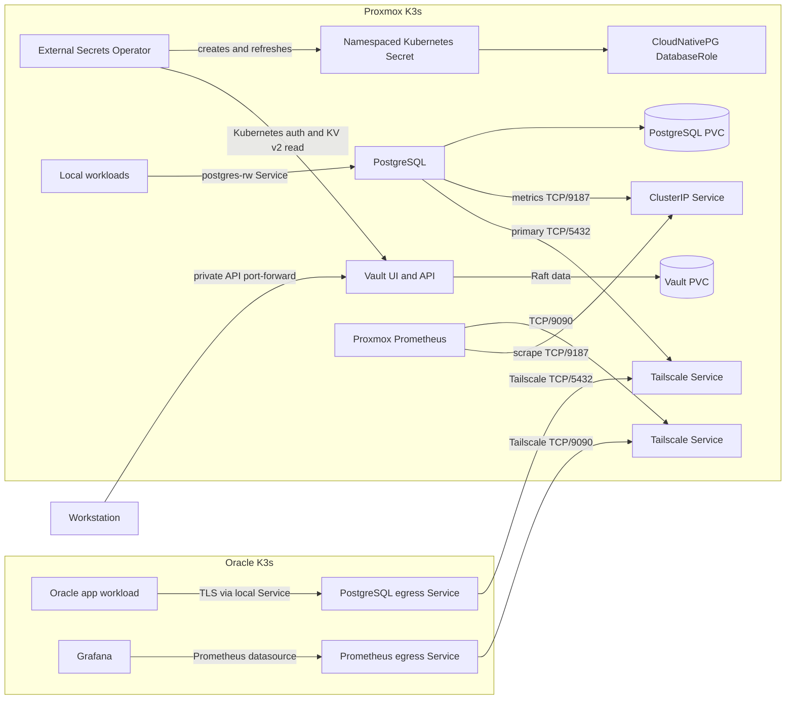

# Proxmox PostgreSQL and Vault

This guide manages the local PostgreSQL database and Vault secret store. Both
stay in the Proxmox K3s cluster. Oracle workloads reach PostgreSQL over
Tailscale. The PostgreSQL exporter stays cluster-local for Proxmox Prometheus;
Oracle Grafana reaches Proxmox Prometheus over Tailscale. The database and
Vault use the VM's `local-path` storage. They are single-instance services,
not highly available.

## Contents

- [Chart choices](#chart-choices)
- [Review and sync](#review-and-sync)
- [Initialize Vault and configure access](#initialize-vault-and-configure-access)
- [Connect to PostgreSQL](#connect-to-postgresql)
- [Update and back up](#update-and-back-up)
- [Stop or remove data services](#stop-or-remove-data-services)



## Chart choices

I compared the current Percona and CloudNativePG PostgreSQL charts. Percona's
`pg-operator` and `pg-db` charts are at 3.1.0. Its `pg-db` defaults to three
PostgreSQL instances and three PgBouncer replicas. It can be tuned, but a
single K3s node cannot provide node-level high availability. See the [Percona
Helm guide](https://docs.percona.com/percona-operator-for-postgresql/latest/helm.html)
and [system requirements](https://docs.percona.com/percona-operator-for-postgresql/latest/System-Requirements.html).

This setup uses the CloudNativePG operator chart 0.29.1 (operator 1.30.1),
with a versioned `Cluster` resource and one PostgreSQL 18 instance. The
companion `cluster` chart is still marked as under active development, so the
GitOps repo manages the stable operator chart and the operator's native
resources directly. See the [CloudNativePG chart repo](https://github.com/cloudnative-pg/charts)
and [1.30 installation and upgrade guide](https://cloudnative-pg.io/docs/1.30/installation_upgrade/).

The current Proxmox node runs K3s 1.37.1. CloudNativePG's current tested
Kubernetes matrix lists versions through 1.36; 1.37 is beyond that tested
range. Percona's current tested platforms also list versions through 1.36.
The CloudNativePG chart itself allows Kubernetes 1.29 and newer, but the
operator has not yet been tested upstream on this node version.

The configured resource requests total about 525m CPU and 1,088 MiB memory:
Vault uses 100m/256 MiB, ESO and its two helper pods use 75m/192 MiB, the
operator uses 100m/128 MiB, and PostgreSQL uses 250m/512 MiB. The data claims
start at 1 GiB for Vault and 10 GiB for PostgreSQL.

Vault uses the official HashiCorp chart 0.34.1 and Vault 2.0.4. It uses Raft
storage with one replica and a 1 GiB PVC. The chart supports Raft, but one
replica is not a failover cluster. See [HashiCorp's Kubernetes Helm guide](https://developer.hashicorp.com/vault/docs/deploy/kubernetes/helm/run)
and [chart configuration](https://developer.hashicorp.com/vault/docs/deploy/kubernetes/helm/configuration).
External Secrets Operator uses Kubernetes authentication and short-lived
service account tokens to copy selected Vault values into namespace Secrets.
See the [Vault provider guide](https://external-secrets.io/v2.14.0/provider/hashicorp-vault/).
Vault audit logging is not enabled because no log retention destination is
configured. Add an audit sink with bounded retention before using Vault for
secrets that need an audit trail.

## Review and sync

Run these commands from the GitOps repository root. Use the Proxmox kubeconfig
and check the context before reading or changing cluster resources:

```bash
export KUBECONFIG="$HOME/.kube/proxmox-k3s.yaml"
kubectl config current-context
kubectl kustomize clusters/proxmox
kubectl diff -k clusters/proxmox
```

The `diff` is a read-only preview. After the pull request is merged, Argo CD
syncs the root and its child applications. Child sync waves order Application
objects, but do not wait for each chart to become ready. The Vault store and
PostgreSQL cluster may retry until their prerequisites are available.

Check resource status without printing Secret data:

```bash
kubectl -n argocd get applications vault external-secrets postgres-operator local-vault-stores postgres
kubectl -n vault-system get statefulset,pods,services,pvc
kubectl -n external-secrets get deployments,pods
kubectl -n postgres get clusters.postgresql.cnpg.io,databaseroles.postgresql.cnpg.io,secretstore,externalsecret,services,pvc
```

## Initialize Vault and configure access

Vault starts sealed. Initialize it once and keep its unseal key and initial
root token outside Git and Kubernetes. Use encrypted offline storage for the
initialization file and later Vault snapshots.

Start a private port-forward to the Vault pod. The local UI and API are not
published through Traefik or a NodePort:

```bash
kubectl -n vault-system port-forward pod/vault-0 8200:8200
```

Open `http://127.0.0.1:8200/ui` for the UI. Keep the Vault pod unsealed before
expecting the ESO stores or the PostgreSQL cluster to become Ready.

The Vault container includes the Vault CLI, so a local Vault CLI is not needed
for status or initialization. Check the state through Kubernetes and initialize
only when it reports `Initialized false`:

```bash
kubectl -n vault-system exec vault-0 -- \
  env VAULT_ADDR=http://127.0.0.1:8200 vault status
```

Choose a writable directory on encrypted offline storage for the key files.
The path below is a placeholder: replace it with your actual path. Do not use
`sudo` to work around a permission error, and do not store these files in Git
or on the cluster VM.

Vault writes the initialization output to a permission-restricted file instead
of printing it:

```bash
umask 077
offline_dir=/path/on/encrypted/offline-storage/proxmox-vault
install -d -m 700 "$offline_dir"
test -w "$offline_dir" || { echo "Directory is not writable"; exit 1; }
kubectl -n vault-system exec vault-0 -- \
  env VAULT_ADDR=http://127.0.0.1:8200 \
  vault operator init -key-shares=1 -key-threshold=1 -format=json \
  > "$offline_dir/init.json" && \
  jq -er '.unseal_keys_b64[0]' "$offline_dir/init.json" \
    > "$offline_dir/unseal-key" && \
  jq -er '.root_token' "$offline_dir/init.json" \
    > "$offline_dir/root-token" && \
  rm "$offline_dir/init.json"
```

If initialization fails, stop and check `vault status`. Do not run
initialization again if it reports `Initialized true`. If key extraction
fails, keep `init.json` private; it may contain the only copy of the keys.

Keep the root token and unseal key separate in encrypted offline storage. This
single-share setup fits one home-cluster operator; losing the key prevents
unsealing, and anyone with it can unseal Vault.

Unseal the server using the interactive prompt:

```bash
kubectl -n vault-system exec -it vault-0 -- \
  env VAULT_ADDR=http://127.0.0.1:8200 sh
```

In the pod shell, run `vault operator unseal` and enter the unseal key at its
prompt. The shell opened by `kubectl exec` does not read the root-token file on
your workstation, so Vault commands there return `403 permission denied` until
you authenticate. Exit the pod shell, then run Vault commands through this
workstation helper. Update the file path if your protected root-token file is
stored elsewhere:

```bash
export KUBECONFIG="$HOME/.kube/proxmox-k3s.yaml"

vault_in_pod() {
  kubectl -n vault-system exec -i vault-0 -- sh -c '
    IFS= read -r VAULT_TOKEN || exit 1
    export VAULT_TOKEN VAULT_ADDR=http://127.0.0.1:8200
    exec vault "$@"
  ' sh "$@" < "$HOME/keys/root-token"
}
```

Check which methods and engines are already enabled. The `kubernetes/` auth
method and `secret/` KV v2 engine should appear in these lists:

```bash
vault_in_pod auth list
vault_in_pod secrets list
```

If either is missing, enable it with `vault_in_pod auth enable kubernetes` or
`vault_in_pod secrets enable -path=secret kv-v2`. Configure Kubernetes auth
only when it is not already configured:

```bash
vault_in_pod write auth/kubernetes/config \
  kubernetes_host=https://kubernetes.default.svc:443
```

The Vault chart grants its service account the Kubernetes
`system:auth-delegator` role; Vault uses its short-lived pod token for
TokenReview. Copy the read-only policies from the repository into the Vault pod
so the in-pod CLI can read them, then load them and bind each to a separate
service account and namespace:

```bash
kubectl cp clusters/proxmox/vault/policies/proxmox-postgres-read.hcl \
  vault-system/vault-0:/tmp/proxmox-postgres-read.hcl
kubectl cp clusters/proxmox/vault/policies/proxmox-apps-read.hcl \
  vault-system/vault-0:/tmp/proxmox-apps-read.hcl
vault_in_pod policy write proxmox-postgres-read /tmp/proxmox-postgres-read.hcl
vault_in_pod policy write proxmox-apps-read /tmp/proxmox-apps-read.hcl
kubectl -n vault-system exec vault-0 -- rm /tmp/proxmox-postgres-read.hcl /tmp/proxmox-apps-read.hcl

vault_in_pod write auth/kubernetes/role/proxmox-postgres \
  bound_service_account_names=vault-secret-reader \
  bound_service_account_namespaces=postgres \
  audience=vault policies=proxmox-postgres-read ttl=1h
vault_in_pod write auth/kubernetes/role/proxmox-apps \
  bound_service_account_names=vault-secret-reader \
  bound_service_account_namespaces=disease-prediction \
  audience=vault policies=proxmox-apps-read ttl=1h
```

ESO requests short-lived `vault`-audience tokens for these service accounts.
The `proxmox-postgres` role can read only the PostgreSQL credential paths. The
`proxmox-apps` role can read app entries and the dev database credential; it
is bound only to the `disease-prediction` namespace. ESO has cluster-wide
Kubernetes permissions because it serves two namespaces; keep its
`ExternalSecret` resources in reviewed Git changes.

Store separate passwords at
`secret/proxmox/postgres/disease-prediction-dev` and
`secret/proxmox/postgres/disease-prediction-prod`, each in the `password`
field. For a new setup or password rotation, generate each password locally,
then copy it into Vault without printing it. The Oracle OCI secret
`proxmox-postgres-credentials` must contain the same dev password. Update that
OCI secret securely before rotating the dev password. Production will use its
own OCI secret when its application is prepared.

```bash
umask 077
vault_in_pod kv get -field=password secret/proxmox/postgres/disease-prediction \
  > /secure/path/postgres-password-dev
openssl rand -hex 32 > /secure/path/postgres-password-prod
kubectl cp /secure/path/postgres-password-dev \
  vault-system/vault-0:/tmp/postgres-password-dev
kubectl cp /secure/path/postgres-password-prod \
  vault-system/vault-0:/tmp/postgres-password-prod
vault_in_pod kv put secret/proxmox/postgres/disease-prediction-dev \
  password=@/tmp/postgres-password-dev
vault_in_pod kv put secret/proxmox/postgres/disease-prediction-prod \
  password=@/tmp/postgres-password-prod
kubectl -n vault-system exec vault-0 -- rm /tmp/postgres-password-dev /tmp/postgres-password-prod
rm /secure/path/postgres-password-dev /secure/path/postgres-password-prod
```

Do not put passwords in command arguments, terminal output, or Git. The
`postgres-app-credentials-dev` and `postgres-app-credentials-prod`
ExternalSecrets create namespace-local Kubernetes Secrets. CloudNativePG uses
them to create the login roles; Oracle uses the dev credential copied to OCI
Vault. The Secrets are encrypted at rest by K3s, but Vault remains the source
of truth.

Dev and production use separate databases, login roles, and passwords on this
PostgreSQL cluster: `disease_prediction_dev` and `disease_prediction_prod`.
They share the cluster's CPU, storage, and availability. The old
`disease_prediction` database and role were removed after the dev connection
was verified. Their data was not migrated.

The `postgres-app-credentials-prod` ExternalSecret creates the Kubernetes
credential for CloudNativePG. The production role and database are retained
when their manifests are removed. For an Oracle production application, copy
the same password into a separate OCI Vault secret; do not reuse the dev
credential. Keep the production credential out of Git, shell arguments, and
terminal output. Use the OCI secret name `proxmox-postgres-credentials-prod`
when preparing the production app.

Remove the helper from the shell when finished. Its token is read from the
protected file for each command and exists in the pod process only while that
command runs:

```bash
unset -f vault_in_pod
```

For an application secret, write its fields under
`secret/proxmox/apps/<app-name>`, then add an `ExternalSecret` in that
application's namespace. For example, this creates a Secret named
`app-credentials` from one Vault field:

```yaml
apiVersion: external-secrets.io/v1
kind: ExternalSecret
metadata:
  name: app-credentials
  namespace: disease-prediction
spec:
  refreshInterval: 1h
  secretStoreRef:
    name: local-vault
    kind: SecretStore
  target:
    name: app-credentials
    creationPolicy: Owner
  data:
    - secretKey: api-key
      remoteRef:
        key: proxmox/apps/disease-prediction
        property: api-key
```

Commit only the ExternalSecret reference and its target name. Keep secret
values in Vault and use the read-only policy for the application's namespace.

Wait for both namespace stores and the PostgreSQL ExternalSecret to become
Ready. Check status and names only:

```bash
kubectl -n postgres get secretstore local-vault
kubectl -n postgres get externalsecret postgres-app-credentials-dev \
  postgres-app-credentials-prod
kubectl -n postgres get secret postgres-app-credentials-dev \
  postgres-app-credentials-prod -o name
kubectl -n disease-prediction get secretstore local-vault
kubectl -n disease-prediction get externalsecret postgres-app-credentials
kubectl -n disease-prediction get secret postgres-app-credentials -o name
```

## Connect to PostgreSQL

Local workloads use the ClusterIP service
`postgres-rw.postgres.svc.cluster.local:5432`. For a workstation session,
keep the private port-forward open and let `psql` prompt for the password:

```bash
kubectl -n postgres port-forward service/postgres-rw 5432:5432
psql -h 127.0.0.1 -p 5432 -U disease_prediction_dev \
  -d disease_prediction_dev -W
```

There is no public route or PgBouncer deployment. The two LoadBalancer
Services use the Tailscale load balancer class and are available only through
the tailnet. The cluster has one database instance and stops during node or VM
downtime.

Oracle workloads use the mirror Service
`proxmox-postgres.disease-prediction.svc.cluster.local:5432`. Configure
PostgreSQL TLS with `sslmode=verify-full` and the `ca.crt` file from the
`postgres-server-ca` Secret. The CNPG server certificate includes both the
Tailscale hostname and the Oracle Service DNS name, so hostname verification
matches this connection path. Keep the database username and password in the
`postgres-app-credentials` Secret; do not put them in application manifests.
CloudNativePG adds these DNS names to its generated server certificate through
`serverAltDNSNames` ([certificate configuration](https://cloudnative-pg.io/docs/1.29/cloudnative-pg.v1/)).
CloudNativePG maintains the additional primary and metrics Services from the
`managed.services.additional` configuration using its native Service
management support ([service management](https://cloudnative-pg.io/docs/1.28/service_management/)).

The Oracle Secret is synced from OCI Vault. Before syncing its ExternalSecrets,
create these OCI Vault secret names with JSON payloads matching the requested
properties:

| OCI Vault secret | JSON property | Value |
|---|---|---|
| `proxmox-postgres-credentials` | `password` | The dev password for `disease_prediction_dev`, copied from Proxmox Vault |
| `proxmox-postgres-credentials-prod` | `password` | The separate production password for `disease_prediction_prod` |
| `proxmox-postgres-server-ca` | `ca_crt` | The public CA certificate from the Proxmox `postgres-ca` Secret |

For example, the credential payload has the form `{"password":"..."}` and
the CA payload uses a `ca_crt` property containing the PEM certificate. Use
the OCI Console or another secure secret-entry method. Keep the database
password out of Git, shell arguments, logs, and command output. The CA is
public, but deliver it through the same Vault workflow so Oracle ESO can
create its Kubernetes Secret consistently. The Oracle provider reads named
properties from JSON secret payloads ([provider documentation](https://external-secrets.io/latest/provider/oracle-vault/)).

These OCI Vault entries are copies of values in the Proxmox Vault, not a live
Vault-to-Vault sync. Update the OCI credential secret whenever you rotate the
PostgreSQL password in Proxmox Vault, then verify the Oracle ExternalSecret is
Ready before restarting applications.

To copy the CA to a protected local file without printing it, use a private
path and restrict its permissions:

```bash
umask 077
install -d -m 700 /secure/path
kubectl --kubeconfig "$HOME/.kube/proxmox-k3s.yaml" -n postgres \
  get secret postgres-ca -o jsonpath='{.data.ca\.crt}' |
  base64 --decode > /secure/path/proxmox-postgres-ca.crt
chmod 600 /secure/path/proxmox-postgres-ca.crt
```

The exported file is only an input to the secure OCI Vault secret-entry step;
delete it after the Vault secret is confirmed. The Oracle ExternalSecrets
create `disease-prediction/postgres-app-credentials` and
`disease-prediction/postgres-server-ca`. The Oracle credential contains the
`disease_prediction_dev` login and password.

The cluster-local `postgres-metrics` Service exposes the exporter on TCP/9187.
Proxmox Prometheus scrapes it every 60 seconds with the `proxmox-cnpg` job.
This is metrics collection, not log shipping; the exporter does not expose
PostgreSQL logs.

## Update and back up

Change chart versions and resource settings in the versioned Application and
values files, then review the rendered manifests and Git diff. Argo CD syncs
the change after merge. PostgreSQL major-version changes need a migration plan;
do not edit the image tag as a routine update.

Vault seals after a restart. Unseal it with the offline key before expecting
ESO to refresh secrets. Save periodic Raft snapshots to encrypted storage:

```bash
vault operator raft snapshot save /secure/path/proxmox-vault.snap
```

No off-node PostgreSQL backup target is configured. The 10 GiB database PVC
and 1 GiB Vault PVC use the VM's local disk, and the `local-path` StorageClass
does not support volume expansion. Before storing data that must survive VM
or disk loss, choose an off-node backup destination and configure a retention
policy. Keep a separate copy of the Vault unseal key; a Vault snapshot does
not replace it.

## Stop or remove data services

Automatic pruning is disabled. Removing a manifest from Git does not remove
its Argo CD Application or data resources. Before removal, make and verify
backups. To stop PostgreSQL and keep its data, add this annotation to the
`Cluster` metadata and let Argo CD sync it:

```yaml
metadata:
  annotations:
    cnpg.io/hibernation: "on"
```

CloudNativePG stops the database pods and keeps the PVCs. Keep the hibernated
`Cluster` resource; deleting it also deletes its PVCs. See the
[CloudNativePG hibernation guide](https://cloudnative-pg.io/docs/1.30/declarative_hibernation/).

To remove the PostgreSQL data permanently, verify that a backup can be
restored first. Remove the child Application manifest from Git, then delete
the live child Application so it stops reconciling:

```bash
kubectl -n argocd delete application postgres
kubectl -n postgres delete cluster postgres
```

Deleting the PostgreSQL `Cluster` deletes its PVCs. The current local-path
StorageClass also deletes the local volume when its PVC is deleted. This
permanently removes the database files from the VM. Remove the local Vault
stores and ExternalSecrets before removing ESO. Keep Vault's data PVC and
offline keys until all secret consumers and backups are cleared.

The Vault API uses plain HTTP inside the cluster and is available only through
its ClusterIP service and a private Kubernetes port-forward. Do not add a
public route. Configure Vault TLS before allowing clients outside this cluster
to connect.
