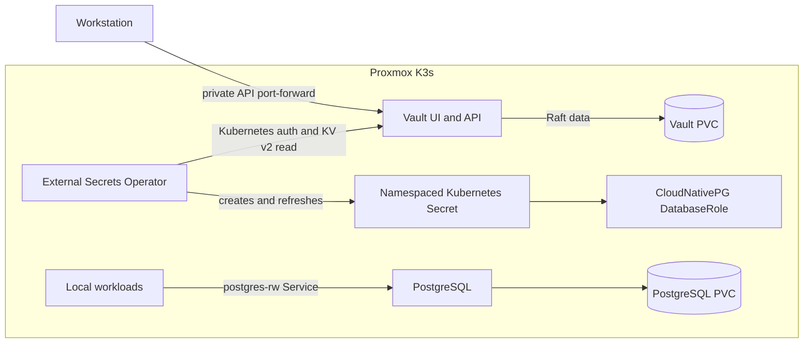

# Proxmox PostgreSQL and Vault

This guide manages the local PostgreSQL database and Vault secret store. Both
stay in the Proxmox K3s cluster. The database and Vault use the VM's
`local-path` storage. They are single-instance services, not highly available.



## Chart choices

I compared the current Percona and CloudNativePG PostgreSQL charts. Percona's
`pg-operator` and `pg-db` charts are at 3.1.0. Its `pg-db` defaults to three
PostgreSQL instances and three PgBouncer replicas. It can be tuned, but a
single K3s node cannot provide node-level high availability. See the [Percona
Helm guide](https://docs.percona.com/percona-operator-for-postgresql/latest/helm.html)
and [system requirements](https://docs.percona.com/percona-operator-for-postgresql/latest/System-Requirements.html).

This setup uses the CloudNativePG operator chart 0.29.1 (operator 1.30.1),
with a versioned `Cluster` resource and one PostgreSQL 18 instance. The
companion `cluster` chart is still marked as under active development, so the
GitOps repo manages the stable operator chart and the operator's native
resources directly. See the [CloudNativePG chart repo](https://github.com/cloudnative-pg/charts)
and [1.30 installation and upgrade guide](https://cloudnative-pg.io/docs/1.30/installation_upgrade/).

The current Proxmox node runs K3s 1.37.1. CloudNativePG's current tested
Kubernetes matrix lists versions through 1.36; 1.37 is beyond that tested
range. Percona's current tested platforms also list versions through 1.36.
The CloudNativePG chart itself allows Kubernetes 1.29 and newer, but the
operator has not yet been tested upstream on this node version.

The configured resource requests total about 525m CPU and 1,088 MiB memory:
Vault uses 100m/256 MiB, ESO and its two helper pods use 75m/192 MiB, the
operator uses 100m/128 MiB, and PostgreSQL uses 250m/512 MiB. The data claims
start at 1 GiB for Vault and 10 GiB for PostgreSQL.

Vault uses the official HashiCorp chart 0.34.1 and Vault 2.0.4. It uses Raft
storage with one replica and a 1 GiB PVC. The chart supports Raft, but one
replica is not a failover cluster. See [HashiCorp's Kubernetes Helm guide](https://developer.hashicorp.com/vault/docs/deploy/kubernetes/helm/run)
and [chart configuration](https://developer.hashicorp.com/vault/docs/deploy/kubernetes/helm/configuration).
External Secrets Operator uses Kubernetes authentication and short-lived
service account tokens to copy selected Vault values into namespace Secrets.
See the [Vault provider guide](https://external-secrets.io/v2.14.0/provider/hashicorp-vault/).
Vault audit logging is not enabled because no log retention destination is
configured. Add an audit sink with bounded retention before using Vault for
secrets that need an audit trail.

## Review and sync

Run these commands from the GitOps repository root. Use the Proxmox kubeconfig
and check the context before reading or changing cluster resources:

```bash
export KUBECONFIG="$HOME/.kube/proxmox-k3s.yaml"
kubectl config current-context
kubectl kustomize clusters/proxmox
kubectl diff -k clusters/proxmox
```

The `diff` is a read-only preview. After the pull request is merged, Argo CD
syncs the root and its child applications. Child sync waves order Application
objects, but do not wait for each chart to become ready. The Vault store and
PostgreSQL cluster may retry until their prerequisites are available.

Check resource status without printing Secret data:

```bash
kubectl -n argocd get applications vault external-secrets postgres-operator local-vault-stores postgres
kubectl -n vault-system get statefulset,pods,services,pvc
kubectl -n external-secrets get deployments,pods
kubectl -n postgres get clusters.postgresql.cnpg.io,databaseroles.postgresql.cnpg.io,secretstore,externalsecret,services,pvc
```

## Initialize Vault and configure access

Vault starts sealed. Initialize it once and keep its unseal key and initial
root token outside Git and Kubernetes. Use encrypted offline storage for the
initialization file and later Vault snapshots.

Start a private port-forward to the Vault pod. The local UI and API are not
published through Traefik or a NodePort:

```bash
kubectl -n vault-system port-forward pod/vault-0 8200:8200
```

Open `http://127.0.0.1:8200/ui` for the UI. Keep the Vault pod unsealed before
expecting the ESO stores or the PostgreSQL cluster to become Ready.

In another terminal, initialize Vault. The command writes the keys to a
permission-restricted file instead of printing them:

```bash
export VAULT_ADDR=http://127.0.0.1:8200
umask 077
offline_dir=/secure/offline/proxmox-vault
install -d -m 700 "$offline_dir"
vault operator init -key-shares=1 -key-threshold=1 -format=json \
  > "$offline_dir/init.json"
jq -er '.unseal_keys_b64[0]' "$offline_dir/init.json" \
  > "$offline_dir/unseal-key"
jq -er '.root_token' "$offline_dir/init.json" \
  > "$offline_dir/root-token"
rm "$offline_dir/init.json"
```

The `/secure/offline` path must be encrypted offline storage with restricted
access. Keep the root token and unseal key separate. This single-share setup
fits one home-cluster operator; losing the key prevents unsealing, and anyone
with it can unseal Vault.

Unseal the server using the interactive prompt, then enter the root token into
the shell without echoing it:

```bash
vault operator unseal
read -r -s -p 'Vault root token: ' VAULT_TOKEN
printf '\n'
export VAULT_TOKEN
vault status
```

Check `vault auth list` and `vault secrets list`. Enable the Kubernetes auth
method and KV v2 engine only if those paths are not already enabled. The Vault
chart grants its service account the Kubernetes `system:auth-delegator` role;
Vault uses its short-lived pod token for TokenReview.

```bash
vault auth enable kubernetes
vault write auth/kubernetes/config \
  kubernetes_host=https://kubernetes.default.svc:443
vault secrets enable -path=secret kv-v2
```

If `kubernetes/` or `secret/` is already listed, do not enable it again. Load
the read-only policies from this repository and bind each policy to a separate
service account and namespace:

```bash
vault policy write proxmox-postgres-read \
  clusters/proxmox/vault/policies/proxmox-postgres-read.hcl
vault policy write proxmox-apps-read \
  clusters/proxmox/vault/policies/proxmox-apps-read.hcl

vault write auth/kubernetes/role/proxmox-postgres \
  bound_service_account_names=vault-secret-reader \
  bound_service_account_namespaces=postgres \
  audience=vault policies=proxmox-postgres-read ttl=1h
vault write auth/kubernetes/role/proxmox-apps \
  bound_service_account_names=vault-secret-reader \
  bound_service_account_namespaces=disease-prediction \
  audience=vault policies=proxmox-apps-read ttl=1h
```

ESO requests short-lived `vault`-audience tokens for these service accounts.
The `proxmox-postgres` role can read only the PostgreSQL credential path. The
`proxmox-apps` role can read app entries and that one database credential; it
is bound only to the `disease-prediction` namespace. ESO has cluster-wide
Kubernetes permissions because it serves two namespaces; keep its
`ExternalSecret` resources in reviewed Git changes.

Write the PostgreSQL password to Vault at
`secret/proxmox/postgres/disease-prediction` with the field `password`. For
example, keep the value in a protected local file and pass only its path to the
CLI:

```bash
vault kv put secret/proxmox/postgres/disease-prediction \
  password=@/secure/path/postgres-password
```

Do not put the password in a command argument, terminal output, or Git. The
`postgres-app-credentials` ExternalSecrets create namespace-local Kubernetes
Secrets from this Vault entry. CloudNativePG uses the Secret in `postgres` to
create and rotate the `disease_prediction` role; the copy in
`disease-prediction` is for the application to connect to the database. The
Secrets are encrypted at rest by K3s, but Vault remains the source of truth.
Unset the root token when finished:

```bash
unset VAULT_TOKEN
```

For an application secret, write its fields under
`secret/proxmox/apps/<app-name>`, then add an `ExternalSecret` in that
application's namespace. For example, this creates a Secret named
`app-credentials` from one Vault field:

```yaml
apiVersion: external-secrets.io/v1
kind: ExternalSecret
metadata:
  name: app-credentials
  namespace: disease-prediction
spec:
  refreshInterval: 1h
  secretStoreRef:
    name: local-vault
    kind: SecretStore
  target:
    name: app-credentials
    creationPolicy: Owner
  data:
    - secretKey: api-key
      remoteRef:
        key: proxmox/apps/disease-prediction
        property: api-key
```

Commit only the ExternalSecret reference and its target name. Keep secret
values in Vault and use the read-only policy for the application's namespace.

Wait for both namespace stores and the PostgreSQL ExternalSecret to become
Ready. Check status and names only:

```bash
kubectl -n postgres get secretstore local-vault
kubectl -n postgres get externalsecret postgres-app-credentials
kubectl -n postgres get secret postgres-app-credentials -o name
kubectl -n disease-prediction get secretstore local-vault
kubectl -n disease-prediction get externalsecret postgres-app-credentials
kubectl -n disease-prediction get secret postgres-app-credentials -o name
```

## Connect to PostgreSQL

The database is only a ClusterIP service. Workloads in the local cluster use
`postgres-rw.postgres.svc.cluster.local:5432`. For a workstation session, keep
the private port-forward open and let `psql` prompt for the password:

```bash
kubectl -n postgres port-forward service/postgres-rw 5432:5432
psql -h 127.0.0.1 -p 5432 -U disease_prediction -d disease_prediction -W
```

There is no public route, LoadBalancer, or PgBouncer deployment. The cluster
has one database instance and stops during node or VM downtime.

## Update and back up

Change chart versions and resource settings in the versioned Application and
values files, then review the rendered manifests and Git diff. Argo CD syncs
the change after merge. PostgreSQL major-version changes need a migration plan;
do not edit the image tag as a routine update.

Vault seals after a restart. Unseal it with the offline key before expecting
ESO to refresh secrets. Save periodic Raft snapshots to encrypted storage:

```bash
vault operator raft snapshot save /secure/path/proxmox-vault.snap
```

No off-node PostgreSQL backup target is configured. The 10 GiB database PVC
and 1 GiB Vault PVC use the VM's local disk, and the `local-path` StorageClass
does not support volume expansion. Before storing data that must survive VM
or disk loss, choose an off-node backup destination and configure a retention
policy. Keep a separate copy of the Vault unseal key; a Vault snapshot does
not replace it.

## Stop or remove data services

Automatic pruning is disabled. Removing a manifest from Git does not remove
its Argo CD Application or data resources. Before removal, make and verify
backups. To stop PostgreSQL and keep its data, add this annotation to the
`Cluster` metadata and let Argo CD sync it:

```yaml
metadata:
  annotations:
    cnpg.io/hibernation: "on"
```

CloudNativePG stops the database pods and keeps the PVCs. Keep the hibernated
`Cluster` resource; deleting it also deletes its PVCs. See the
[CloudNativePG hibernation guide](https://cloudnative-pg.io/docs/1.30/declarative_hibernation/).

To remove the PostgreSQL data permanently, verify that a backup can be
restored first. Remove the child Application manifest from Git, then delete
the live child Application so it stops reconciling:

```bash
kubectl -n argocd delete application postgres
kubectl -n postgres delete cluster postgres
```

Deleting the PostgreSQL `Cluster` deletes its PVCs. The current local-path
StorageClass also deletes the local volume when its PVC is deleted. This
permanently removes the database files from the VM. Remove the local Vault
stores and ExternalSecrets before removing ESO. Keep Vault's data PVC and
offline keys until all secret consumers and backups are cleared.

The Vault API uses plain HTTP inside the cluster and is available only through
its ClusterIP service and a private Kubernetes port-forward. Do not add a
public route. Configure Vault TLS before allowing clients outside this cluster
to connect.
