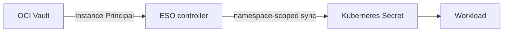

# Secrets from OCI Vault

External Secrets Operator (ESO) reads secrets from OCI Vault and creates
ordinary Kubernetes Secrets for workloads. K3s is configured to encrypt those
Kubernetes Secrets at rest. Secret payloads must not be committed to Git,
Terraform state, terminal output, or logs.



## Trust boundary

The VM's OCI Instance Principal is shared by the VM, not assigned to an ESO
pod. The IAM policy allows reading every secret in the configured Vault; ESO
manifests select which values to sync, but do not limit the OCI identity. A
pod that can reach OCI's instance metadata endpoint may use that identity.
There are no Git-managed NetworkPolicies restricting pod access to OCI metadata
endpoints today.
Check and restrict metadata access before running untrusted workloads. Keep
the Vault read-only and dedicated to this cluster.

Argo CD keeps chart installation separate from application secret references:

| Component | Scope and responsibility |
|---|---|
| `oracle-platform` / `external-secrets` | Installs the pinned ESO chart and its CRDs/webhook. The chart project allows a Secret kind in both configured destinations, but the chart currently renders its webhook Secret only in `external-secrets`. |
| `oracle-apps` / `oci-vault-store` | Manages namespaced `SecretStore` and `ExternalSecret` references in `disease-prediction`; it cannot create ordinary Secrets. |
| `oracle-edge-secrets` / `external-secrets-edge` | Runs a second ESO controller scoped to `edge-system`; shares the CRDs/webhook and creates no cluster-scoped RBAC. Its controller-class setting is experimental. |
| `oracle-auth` / `external-secrets-auth` | Runs a third ESO controller scoped to `auth-system`; it creates Authelia's account, SMTP, and core Secrets from that namespace's `SecretStore`. |
| ESO | Creates the generated Kubernetes Secrets from Vault values. |

The edge store uses controller class `oracle-edge-secrets`. Verify this setup
with a non-sensitive canary before changing it or adding credentials. Do not
put edge credentials in `disease-prediction` or commit ordinary Secret objects.

The chart and image are pinned to 2.14.0, which the ESO support matrix lists
for Kubernetes 1.37. Review the [upstream support matrix](https://external-secrets.io/v2.14.0/introduction/stability-support/)
and [OCI provider guide](https://external-secrets.io/v2.14.0/provider/oracle-vault/)
before upgrading.

## Provision OCI Vault

Use the infrastructure repository to create or adopt the Vault, HSM-backed
master key, exact-instance dynamic group, and read-only policy. Follow its
Terraform plan and apply steps. The cluster policy must only allow read access
to secrets in this Vault.

Use the OCI Console to create or update secret payloads. Do not pass a real
secret as a Terraform input or a literal command argument. The instance
principal is the VM's identity, not a separate Kubernetes identity: treat all
pods that can reach OCI's instance metadata endpoint as part of this trust
boundary. Keep the IAM permission read-only and limited to this Vault.

## Install and check ESO

Review the chart version and restricted app project in Git, then render and
preview the cluster resources. The platform project's workload-namespace
destination is required for the chart's scoped RBAC resources:

```bash
kubectl kustomize clusters/oracle
kubectl diff -k clusters/oracle
```

The root app's sync waves order child Application objects but do not guarantee
that each child app is ready before the next starts. On a fresh bootstrap,
verify that ESO's CRDs are Established before expecting its `SecretStore` and
`ExternalSecret` resources to become Ready.

After the pull request is merged, Argo CD installs ESO. Check the child app and
controller pods without reading Kubernetes Secret data:

```bash
kubectl -n argocd get application external-secrets
kubectl -n external-secrets get deployments,pods
```

After the edge pull request is merged, also check the edge controller and
namespace-scoped Vault store:

```bash
kubectl -n argocd get application external-secrets-edge oci-edge-vault-store
kubectl -n external-secrets get deployment external-secrets-edge
kubectl -n edge-system get secretstore oci-vault-edge
```

Authelia uses its own controller and Vault store in `auth-system`. Its Vault
secret names and payload shapes are documented in the
[Authelia runbook](authelia.md#prepare-the-oci-vault-secrets). Check the
controller, store, and ExternalSecret status only:

```bash
kubectl -n argocd get application external-secrets-auth oci-auth-vault-store
kubectl -n external-secrets get deployment external-secrets-auth
kubectl -n auth-system get secretstore,externalsecrets
```

Terraform provisions the Vault, key, and instance-principal policy. The Vault
OCID and region are metadata, not secret values. The checked-in
`clusters/oracle/managed-secrets/vault-store.yaml` uses those Terraform outputs
and is deployed by the `oci-vault-store` child Application in the `oracle-apps`
project. The provider configuration is:

```yaml
apiVersion: external-secrets.io/v1
kind: SecretStore
metadata:
  name: oci-vault
  namespace: disease-prediction
spec:
  provider:
    oracle:
      vault: <Vault OCID from Terraform output>
      region: <Vault region>
      principalType: InstancePrincipal
```

Add or change this resource through a pull request, only after ESO's CRDs are
established and the actual Vault OCID is available. Wait for the `SecretStore`
Ready condition before adding an `ExternalSecret` to this app path.

## Verify with a temporary canary

Create a disposable secret named `eso-canary` in OCI Vault using a plainly
non-sensitive value. Add a temporary, versioned `ExternalSecret` manifest in
the `disease-prediction` namespace alongside its `SecretStore`:

```yaml
apiVersion: external-secrets.io/v1
kind: ExternalSecret
metadata:
  name: oci-vault-canary
  namespace: disease-prediction
spec:
  refreshInterval: 1m
  secretStoreRef:
    name: oci-vault
    kind: SecretStore
  target:
    name: oci-vault-canary
    creationPolicy: Owner
  data:
    - secretKey: value
      remoteRef:
        key: eso-canary
```

Merge and sync the manifest after the `SecretStore` is Ready. Check resource
conditions and the key name only; never print the Secret's data:

```bash
kubectl -n disease-prediction get secretstore oci-vault
kubectl -n disease-prediction get externalsecret oci-vault-canary
kubectl -n disease-prediction get secret oci-vault-canary \
  -o go-template='{{range $key, $value := .data}}{{printf "%s\n" $key}}{{end}}'
```

The canary secret is not a workload credential. Keep its value out of command
output nonetheless. After the sync succeeds, remove the temporary
`ExternalSecret` manifest from Git. The root app has pruning disabled, so
removing the manifest will not delete the live object automatically:

```bash
kubectl -n disease-prediction delete externalsecret oci-vault-canary
```

Then schedule deletion of the `eso-canary` secret in OCI Vault. ESO's owner
policy removes the generated Kubernetes Secret when its `ExternalSecret` is
deleted. Do not delete the Vault while any workload depends on its secrets.

The edge controller can be verified with a separate canary in OCI Vault. The
`edge-eso-canary` test synced successfully through the `oracle-edge-secrets`
controller class. Remove the temporary `ExternalSecret` and confirm its owned
Kubernetes Secret is gone; automated pruning is disabled. Delete the temporary
Vault secret after cleanup. Repeat this check before changing controller or
Vault settings, and before adding Cloudflare credentials.

The Cloudflare Tunnel connector reads its tunnel-specific credential from the
OCI Vault secret `cloudflared-tunnel`. ESO writes it to the Kubernetes Secret
key `credentials.json` in `edge-system`. Check only the ExternalSecret status
and generated key name:

```bash
kubectl -n edge-system get externalsecret cloudflared-tunnel
kubectl -n edge-system get secret cloudflared-tunnel \
  -o go-template='{{range $key, $value := .data}}{{printf "%s\n" $key}}{{end}}'
```

Never print the generated Secret's value. The ExternalDNS API token will use a
separate Vault secret named `cloudflare-api-token`.

## Add and rotate workload secrets

Store each workload credential in OCI Vault, then add an `ExternalSecret` in
that workload's namespace. Add a namespace-scoped `SecretStore` there as well;
do not use a `ClusterSecretStore`. Workloads reference the generated
Kubernetes Secret by name. Keep the secret name, target Secret name, and key
names in Git, but keep all values in OCI Vault.

To rotate a credential, add a new OCI Vault secret version and wait for ESO's
refresh interval. Check the `ExternalSecret` Ready condition and application
health. Do not print the Kubernetes Secret to verify rotation. Follow the
application's restart or reload behavior if it does not watch Secret changes.

## Remove ESO

Remove workload `ExternalSecret` and `SecretStore` resources first and delete
their live resources explicitly because automated pruning is disabled. Confirm
no generated Secrets or consumers remain, then remove the ESO Application and
namespace through a reviewed Git change. Keep Vault data until all consumers
and recovery requirements are cleared. Do not remove ESO CRDs while ESO custom
resources remain.
